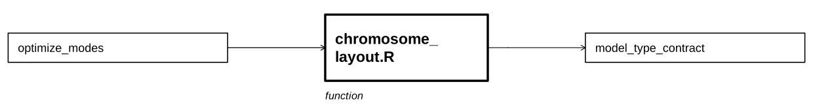

# chromosome_layout.R

**Function** &nbsp;·&nbsp; `30_Simulation/03_Functions/chromosome_layout.R`

## Function

Gives the layout of the chromosome of the genetic algorithm: which genes belong to which asset, and the bounds of each gene. The chromosome is made of blocks, one per asset with genes, in the order of the asset registry (parameters$assets), one block after the other. A block holds one gene per market interval of the horizon, in the order of the intervals. Each gene is a whole number from 1 to the number of options of the genes of its asset, which the operation gene_options of its type of model gives (model_type_contract()). An asset whose type has no genes (0 options) has no block: the genetic algorithm decides nothing for it. With a single asset with genes, the chromosome is its block: one gene per market interval. When no asset has genes, the chromosome is empty: blocks has no rows, n_genes is 0 and the bounds are empty.
<https://github.com/robgaray/Model-Predictive-Control-in-Buildings>

## Called by

- [optimize_modes.R](optimize_modes.md)

## What it calls, in order of appearance

- [model_type_contract.R](model_type_contract.md)

## Input data

- parameters  : Named list. Must contain parameters$assets, the asset registry, one entry per asset with its asset_id and its asset_type.
- n_intervals : Integer scalar. Number of market intervals of the optimization horizon, one gene per asset block.

## Output data

- Named list with the elements:
    - blocks : data frame, one row per asset with genes, in the order of the chromosome, with the columns:
        - asset_id: the asset of the block
        - gene_options: the number of options of each gene of the block
        - first_gene: position of the first gene of the block in the chromosome
        - last_gene: position of its last gene
    - n_genes : integer scalar, the length of the chromosome (0 when no asset has genes)
    - lower   : numeric vector, the lower bound of each gene (1)
    - upper   : integer vector, the upper bound of each gene, the number of options of its asset

## Other notes from the file header

### Code outline

1. Check the number of intervals
2. The number of options of the genes of each asset
3. The blocks one after the other
4. The bounds of each gene

### Usage instructions

```r
layout <- chromosome_layout(
  parameters  = parameters,
  n_intervals = length(timestamps$target_periods)
  )
```

## Diagram



Also available as [chromosome_layout.svg](chromosome_layout.svg).

---

[Back to the code structure index](../Code_Structure.md)
