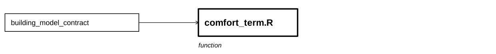

# comfort_term.R

**Function** &nbsp;·&nbsp; `30_Simulation/05_Models/01_Building/03_Functions/comfort_term.R`

## Function

Computes the comfort part of the reward, row by row, over the three itineraries of a candidate: the plan and the two flexibility legs. It is the asset side of the reward: it reads the comfort flags the building simulation wrote, and nothing of the energy, the prices or the commitments. A row is penalized when ANY of the three itineraries is out of its own comfort band at that row. Committing to a service that leaves the building outside comfort in the itinerary that would actually be flown is not an acceptable commitment, whichever of the two legs it belongs to. Where nothing is committed, and outside the flexibility windows, both flex comfort columns are the copy of Comfort_plan that derive_flex_itineraries() made, so the "or" adds no false penalty there. Every time step counts, occupied or not: each itinerary carries its own band (the plan band, or the occupancy band inside a flexibility window), and outside occupancy and the scheduling window that band is the setback band. The penalty is the length of the row in hours, with a negative sign, times alpha_comfort (1/h), so the term is dimensionless, like alpha_cost (1/EUR) times each economic term (EUR). alpha_comfort is a parameter of the building, in its comfort group: each building weighs its own comfort, and the reward adds the comfort terms of all of them. Comfort is never discounted: prudence is about what the building expects to earn, not about whether people are comfortable.
<https://github.com/robgaray/Model-Predictive-Control-in-Buildings>

## Called by

- [building_model_contract.R](building_model_contract.md)

## What it calls, in order of appearance

- Nothing: this piece calls no other piece of the project.

## Input data

- period_chunk  : Data frame. Planning-period data with the columns:
    - time: POSIXct. Simulation timestamps.
    - Comfort_plan: Numeric (0/1).
    - Comfort_plan_flex_down: Numeric (0/1).
    - Comfort_plan_flex_up: Numeric (0/1).
- asset         : Named list. The parameters of the building, its entry of parameters$assets. Every operation of the type of model receives them (model_type_contract()). The comfort of a building reads the weight of its comfort term, asset$comfort$alpha_comfort (1/h). The comfort flags are already in period_chunk.

## Output data

- Numeric vector, one value per row of period_chunk: the weighted comfort term of the row (dimensionless, 0 in comfort, negative out of it).

## Other notes from the file header

### Code outline

0. The weight of the comfort term of the building
1. Time step of each row
2. Hours out of comfort, weighted

### Usage instructions

```r
comfort <- comfort_term(period_chunk, parameters$assets[[1]])
```

### Exceptions and special cases

- If asset$comfort$alpha_comfort is NULL, stop() is called immediately (no default value is used).

## Diagram



Also available as [comfort_term.svg](comfort_term.svg).

---

[Back to the code structure index](../Code_Structure.md)
