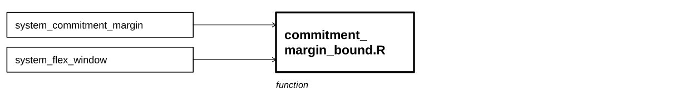

# commitment_margin_bound.R

**Function** &nbsp;·&nbsp; `30_Simulation/03_Functions/commitment_margin_bound.R`

## Function

Gives the commitment band of every market interval of a flexibility window: the net electricity the itinerary of the leg may reach in that interval once flexibility_commitment_margin is kept, and the least a new window may sell in it, minimum_flexibility. It is the side of the system in the shaping of a window: it knows only energy per row, the market interval of each row and the margin. The margin is one, of the set of assets that contribute to the window, so the band is measured on their net electricity and on the limit of the set. How the assets fit inside it is decided by system_commitment_margin(); with what system and at which heat, is not known here.

The two bounds
The margin is a power, so it is turned into the energy of each interval with the hours its rows cover. limit_energy is, row by row, the net electricity of the set at the limit of the leg: the sum of what each asset draws at that limit.

- Upward: the most the itinerary may draw in the interval, which is
- what the set draws at the ceiling of the window, less the margin.
- Downward: the least the itinerary may draw in the interval, which
- is what the set draws at its floor, plus the margin. A building
- draws nothing at its floor, with both systems off.

The minimum of an interval

minimum_flexibility is a power too. A new window sells, in each interval, nothing or at least that power times the length of the market interval, market_resolution. It is the same for every interval and both legs, and it is compared with the electricity the interval sells, never with heat.

How an interval adds up

The energy and the hours of an interval are added with sum() and the rows that are missing are left out, in the order of the rows.

## Called by

- [system_commitment_margin.R](system_commitment_margin.md)
- [system_flex_window.R](system_flex_window.md)

## What it calls, in order of appearance

- Nothing: this piece calls no other piece of the project.

## Input data

- All the vectors are the same length, one entry per row of the Commitment Phase.
- limit_energy : Numeric vector. The net electricity (kWh) the set of assets draws on each row at the limit of the leg: the ceiling of the window upward, the floor downward.
- market_slot  : Vector. The market interval each row belongs to.
- delta_t_h    : Numeric vector. Timestep of each row in hours.
- leg          : Character, "up" or "down".
- parameters   : Named list. Reads:
    - parameters$control$flexibility_commitment_margin (kW)
    - parameters$control$minimum_flexibility (kW)
    - parameters$market$market_resolution (min)

## Output data

- Named list with: slot_id : Integer vector, one entry per row. The number of the market interval of the row, in the order the intervals first appear, from 1. A row whose interval is missing takes 0: it belongs to no interval and no bound applies to it. bound   : Numeric vector, one entry per interval number. The net electricity (kWh) the itinerary of the leg may reach in the interval: at most this upward, at least this downward. minimum : Numeric vector, one entry per interval number. The least electricity (kWh) a new window may sell in the interval when it sells anything.

## Other notes from the file header

### Code outline

1. Number the market intervals.
2. The bound of every interval.
3. The minimum of every interval.

### Usage instructions

```r
band <- commitment_margin_bound(limit_energy = limit_energy,
  market_slot  = market_slot,
  delta_t_h    = delta_t_h,
  leg          = "up",
  parameters   = parameters)
```

## Diagram



Also available as [commitment_margin_bound.svg](commitment_margin_bound.svg).

---

[Back to the code structure index](../Code_Structure.md)
