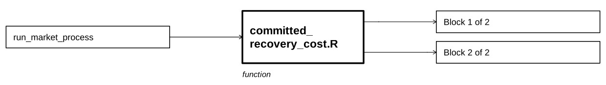

# committed_recovery_cost.R

**Function** &nbsp;·&nbsp; `30_Simulation/03_Functions/committed_recovery_cost.R`

## Function

Values, once per market, the expected cost of the Recovery Phase of the itineraries already committed, and the value of the energy they leave stored, and adds them to the market's marginal_context. economic_terms() values the Recovery Phase of each candidate as the change against it, so that a candidate whose itineraries are the committed ones adds nothing, whatever the aim. The committed itineraries are rebuilt the way every candidate is built:

- the plan of each asset is simulated, in its view of the piece, with the setpoints already committed, from the state at the start of the horizon and with the forecast of this market; a row whose setpoints no market has determined takes those of the lowest-numbered mode; the assets that read the net electricity of the rest of the system (operation reads_rest_net of their type of model) are simulated after the others (asset_simulation_order()), with the electricity of the committed plan of those in their view (write_rest_net());
- derive_flex_itineraries() draws over that plan, on the piece, the flexibility earlier markets sold, with the alternative of the Recovery Phase that has the best reward when an asset offers several (build_recovery_valuation()), as for a candidate;
- their Recovery Phase is valued with this market's prices, exactly as economic_terms() values a candidate's;
- when an asset stores energy, the value of the energy the committed plan leaves stored, and that of the energy each committed leg leaves stored against the plan, which economic_terms() takes as the reference of its own terms of stored energy.

The derivation is handed back with the plan it was drawn over. A market that keeps its plan (aims "operation" and "operationflex") simulates that same plan again and draws the same itineraries over it, so it takes them from here instead of drawing them a second time, when its plan and its control are identical.

## Called by

- [run_market_process.R](run_market_process.md)

## What it calls, in order of appearance

- [asset_simulation_order.R](asset_simulation_order.md)
- [model_type_contract.R](model_type_contract.md)
- [piece_asset_view.R](piece_asset_view.md)
- [write_rest_net.R](write_rest_net.md)
- [piece_absorb_asset.R](piece_absorb_asset.md)
- [build_recovery_valuation.R](build_recovery_valuation.md)
- [derive_flex_itineraries.R](derive_flex_itineraries.md)
- [system_stored_energy.R](system_stored_energy.md)
- [build_reward_cache.R](build_reward_cache.md)
- [system_energy_rows.R](system_energy_rows.md)
- [flex_leg_reward_terms.R](flex_leg_reward_terms.md)

## Blocks

The piece calls 11 items, so it is documented in blocks:

- [Called items, block 1 of 2](committed_recovery_cost__1.md)
- [Called items, block 2 of 2](committed_recovery_cost__2.md)

## Input data

- piece              : List. The piece of the optimization horizon of the market, before the optimization: its *_plan setpoints and its committed flexibility are those of the earlier markets.
- parameters         : Named list. Model parameters. Its asset registry (parameters$assets) gives the type of model of each asset (model_type_contract()), and parameters$joined_cols the column order of the view of an asset.
- simulation_control : Named list. The control object the market optimizes with, as handed to derive_flex_itineraries().
- marginal_context   : Named list, as returned by resolve_marginal_context().

## Output data

- A named list with:
- marginal_context : The marginal_context received, with two more elements (EUR):
    - recovery_cost_committed_down
    - recovery_cost_committed_up

and, only when an asset stores energy, three more (EUR):

- stored_value_committed_plan
- stored_value_committed_down
- stored_value_committed_up
- derivation       : Named list. The committed flexibility drawn over the committed plan:
    - piece: the piece with the committed plan simulated, before the derivation.
    - simulation_control: the control the derivation was drawn with.
    - derived: what derive_flex_itineraries() gave over that piece.

## Other notes from the file header

### Code outline

1. The committed plan of each asset, under this market's information
2. The committed flexibility, drawn over that plan
3. Recovery Phase cost of each leg and value of the stored energy
4. The derivation handed back

### Usage instructions

```r
committed <- committed_recovery_cost(piece, parameters,
  simulation_control,
  marginal_context)
```

marginal_context <- committed$marginal_context

## Diagram



Also available as [committed_recovery_cost.svg](committed_recovery_cost.svg).

---

[Back to the code structure index](../Code_Structure.md)
