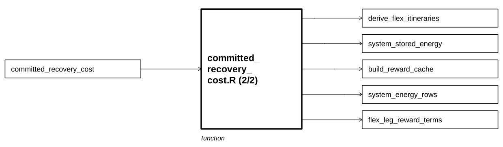

# committed_recovery_cost.R &mdash; Called items, block 2 of 2

Block 2 of 2 of [committed_recovery_cost.R](committed_recovery_cost.md).

## What it calls, in this block

- [derive_flex_itineraries.R](derive_flex_itineraries.md)
- [system_stored_energy.R](system_stored_energy.md)
- [build_reward_cache.R](build_reward_cache.md)
- [system_energy_rows.R](system_energy_rows.md)
- [flex_leg_reward_terms.R](flex_leg_reward_terms.md)

## Diagram

Also available as [committed_recovery_cost__2.svg](committed_recovery_cost__2.svg).

---

[Back to committed_recovery_cost.R](committed_recovery_cost.md) &nbsp;·&nbsp; [Back to the code structure index](../Code_Structure.md)
