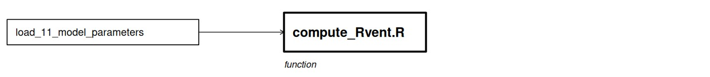

# compute_Rvent.R

**Function** &nbsp;·&nbsp; `30_Simulation/03_Functions/compute_Rvent.R`

## Function

This function converts Air Change per Hour (ACH) ventilation rates (RENventXX) into thermal ventilation resistances (RventXX) used by the building simulation model. It also computes the equivalent resistances for the heat recovery mode (RventXX_HR).

## Called by

- [load_11_model_parameters.R](load_11_model_parameters.md)

## What it calls, in order of appearance

- Nothing: this piece calls no other piece of the project.

## Input data

- model_parameters    : Named list. Must include: RENvent01    - Infiltration ACH rate (h-1) RENvent1     - Night ventilation ACH rate (h-1) RENvent2     - Day ventilation ACH rate (h-1) Efi_Vent_Rec - Heat recovery efficiency (0-1) Volume       - Building volume (m3)
- physical_properties : Named list. Must include: Cp_air   - Specific heat of air (kJ/(kg·K)) dens_air - Density of air (kg/m3)

## Output data

- model_parameters : Named list. The input list extended with: Rvent01    - Thermal resistance, infiltration (K/kW) Rvent1     - Thermal resistance, night vent (K/kW) Rvent2     - Thermal resistance, day vent (K/kW) Rvent01_HR - Rvent01 with heat recovery (K/kW) Rvent1_HR  - Rvent1 with heat recovery (K/kW) Rvent2_HR  - Rvent2 with heat recovery (K/kW)

## Other notes from the file header

### Code outline

1. Extract conversion constants from physical_properties
2. Compute RventXX for each ACH rate
3. Compute RventXX_HR using heat recovery efficiency

### Usage instructions

```r
model_parameters <- compute_Rvent(model_parameters, physical_properties)
```

## Diagram



Also available as [compute_Rvent.svg](compute_Rvent.svg).

---

[Back to the code structure index](../Code_Structure.md)
