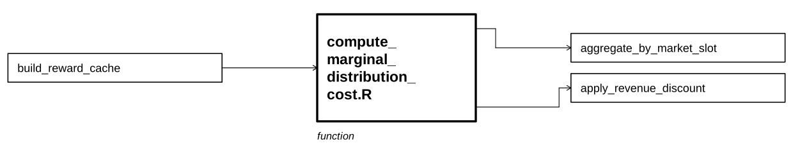

# compute_marginal_distribution_cost.R

**Function** &nbsp;·&nbsp; `30_Simulation/03_Functions/compute_marginal_distribution_cost.R`

## Function

Values a candidate energy schedule (from a single GA candidate's period_calculation() output) at its marginal (differential) distribution-cost impact relative to a fixed baseline, per target market interval. The distribution cost is settled on the net energy of each time step: an executed step pays the distribution rate on the absolute value of the energy it exchanges with the grid, whether it imports or exports (settle_execution()). The candidate is valued the same way: its gross volume in an interval is the sum, over the time steps of the interval, of the absolute energy of each step, and the change of that gross volume against the committed one is valued at the interval's distribution rate:

- cost = -distribution_rate * (gross_new - gross_orig)

Unlike compute_marginal_energy_cost(), this does NOT use calc_differential_cost(): buying, selling and unwinding energy all incur the same rate regardless of direction, so only the gross volume matters. A step that moves from import to export is handled by the absolute value itself. Steps of one interval that import and export do not offset each other: each pays its own volume, as it does when it is executed. Its sign is set so that, like every other economic term in this repository, an expense is negative. An interval whose gross volume shrinks gives a positive entry, a saving against what was committed. Only used for the base-energy term of reward_function() - explicitly not applied to flexibility.

## Called by

- [build_reward_cache.R](build_reward_cache.md)

## What it calls, in order of appearance

- [aggregate_by_market_slot.R](aggregate_by_market_slot.md)
- [apply_revenue_discount.R](apply_revenue_discount.md)

## Input data

- E_candidate         : Numeric vector. Per-timestep energy of the candidate being evaluated (Elec_total_plan of a period_chunk), one value per fine timestep.
- slot_index          : Factor, same length as E_candidate. Target market interval of each fine timestep, as returned by market_slot_index(); its levels follow the order of every *_by_market argument below.
- E_orig_gross_by_market : Numeric vector, same length/order as the levels of slot_index. Gross volume committed per target interval before this market's optimization: the sum of the absolute energy of its time steps.
- distribution_rate_by_market : Numeric vector, same length/order as the levels of slot_index. Current-market Elec_unit_cost_distribution rate per target interval.
- discount_by_market  : Numeric vector, same length/order as the levels of slot_index. Revenue discount factor of each target interval, as returned by revenue_discount_factor(). It weighs the positive entries, the savings, like any other income; the expenses are not discounted.

## Output data

- Numeric scalar. Total marginal distribution cost (negative = added cost, positive = reduced cost) of moving every target interval's gross volume from E_orig_gross_by_market to the candidate's.

## Other notes from the file header

### Code outline

1. Gross volume of the candidate per target market interval
2. Distribution cost per interval, discounted, and total

### Usage instructions

```r
cost <- compute_marginal_distribution_cost(E_candidate, slot_index,
  E_orig_gross_by_market, distribution_rate_by_market,
  discount_by_market)
```

## Diagram



Also available as [compute_marginal_distribution_cost.svg](compute_marginal_distribution_cost.svg).

---

[Back to the code structure index](../Code_Structure.md)
