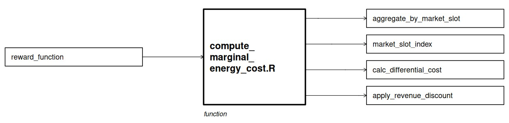

# compute_marginal_energy_cost.R

**Function** &nbsp;·&nbsp; `30_Simulation/03_Functions/compute_marginal_energy_cost.R`

## Function

Values a candidate energy schedule (from a single GA candidate's period_calculation() output) at its marginal (differential) cost relative to a fixed baseline, per target market interval, using the same calc_differential_cost() already used for post-hoc market accounting in integrate_market_process()/propagate_differential_cost(). The candidate's per-timestep energy is first aggregated (SUM) per market interval, exactly as integrate_market_process() aggregates E_new_*_by_market, and explicitly aligned to the target-interval key (market_utc) rather than relying on any implicit ordering, since the candidate's own MarketUTC vector may not list intervals in the same order every time this is called (it is called once per GA candidate evaluated).

## Called by

- [reward_function.R](reward_function.md)

## What it calls, in order of appearance

- [aggregate_by_market_slot.R](aggregate_by_market_slot.md)
- [market_slot_index.R](market_slot_index.md)
- [calc_differential_cost.R](calc_differential_cost.md)
- [apply_revenue_discount.R](apply_revenue_discount.md)

## Input data

- E_candidate         : Numeric vector. Per-timestep energy of the candidate being evaluated (e.g. Elec_total_plan, Elec_total_plan_flex_down or Elec_flex_down_plan of a period_chunk), one value per fine timestep.
- MarketUTC_candidate  : POSIXct vector, same length as E_candidate. Market interval of each fine timestep.
- market_utc          : POSIXct vector. Target market intervals, in the order matching every *_by_market argument below (as returned by resolve_marginal_context()).
- E_orig_by_market    : Numeric vector, same length/order as market_utc. Baseline commitment per target interval, before this market's optimization.
- P_import_buy_by_market, P_import_sell_by_market, P_export_buy_by_market, P_export_sell_by_market : Numeric vectors, same length/order as market_utc. Current-market prices per target interval, passed straight through to calc_differential_cost() (see that function's header for their meaning). A flexibility caller maps its own up/down prices into these same four slots.
- discount_by_market  : Numeric vector, same length/order as market_utc. Revenue discount factor of each target interval, as returned by revenue_discount_factor(). It weighs down the intervals whose cash flow is an income far from the decision instant, and only those - see apply_revenue_discount().

## Output data

- Numeric scalar. Total marginal cash flow (positive = net income, negative = net expense) of moving every target interval's commitment from E_orig_by_market to the candidate's aggregated commitment, with the income of each interval discounted by its own factor.

## Other notes from the file header

### Code outline

1. Aggregate the candidate's energy per target market interval
2. Differential cost per interval, discounted, and total

### Usage instructions

```r
cost <- compute_marginal_energy_cost(E_candidate, MarketUTC_candidate, market_utc, E_orig_by_market, P_import_buy_by_market, P_import_sell_by_market, P_export_buy_by_market, P_export_sell_by_market, discount_by_market)
```

## Diagram



Also available as [compute_marginal_energy_cost.svg](compute_marginal_energy_cost.svg).

---

[Back to the code structure index](../Code_Structure.md)
