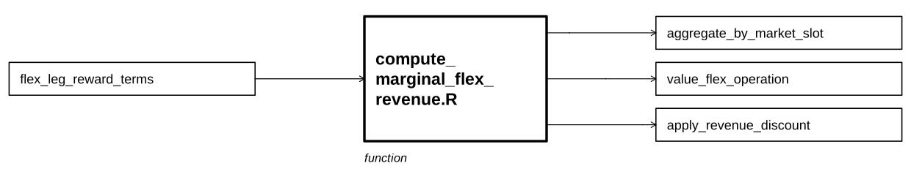

# compute_marginal_flex_revenue.R

**Function** &nbsp;·&nbsp; `30_Simulation/03_Functions/compute_marginal_flex_revenue.R`

## Function

Values a candidate explicit-flexibility schedule (from a single GA candidate's period_calculation() output) at its marginal (differential) revenue relative to a fixed baseline, per target market interval, using value_flex_operation() - the down/up-leg valuation, NOT calc_differential_cost() (see that function's header for why explicit flexibility cannot be valued the same way energy is). Mirrors compute_marginal_energy_cost()'s structure: the candidate's per-timestep flexibility commitment is first aggregated (SUM) per market interval, exactly as settle_market() aggregates E_by_market$new, and explicitly aligned to the target-interval key (market_utc) rather than relying on any implicit ordering, since the candidate's own MarketUTC vector may not list intervals in the same order every time this is called (it is called once per GA candidate evaluated).

## Called by

- [flex_leg_reward_terms.R](flex_leg_reward_terms.md)

## What it calls, in order of appearance

- [aggregate_by_market_slot.R](aggregate_by_market_slot.md)
- [value_flex_operation.R](value_flex_operation.md)
- [apply_revenue_discount.R](apply_revenue_discount.md)

## Input data

- E_candidate         : Numeric vector. Per-timestep explicit flexibility commitment of the candidate being evaluated, one value per fine timestep. It is one leg's signal, not both: Elec_flex_down_plan for the down leg, -Elec_flex_up_plan for the up leg, since value_flex_operation() tells the two apart by sign and both signals are non-negative.
- slot_index          : Factor, same length as E_candidate. Target market interval of each fine timestep, as returned by market_slot_index(); its levels follow the order of every *_by_market argument below.
- E_orig_by_market    : Numeric vector, same length/order as the levels of slot_index. Baseline commitment per target interval, before this market's optimization.
- price_down_sell_by_market, price_down_buy_by_market, price_up_sell_by_market, price_up_buy_by_market : Numeric vectors, same length/order as the levels of slot_index. Effective down/up flexibility prices per target interval, as returned by resolve_marginal_context().
- discount_by_market  : Numeric vector, same length/order as the levels of slot_index. Revenue discount factor of each target interval, as returned by revenue_discount_factor(). It weighs down the intervals that pay and only those - see apply_revenue_discount().
- capped_by_market    : Logical vector, same length/order as the levels of slot_index. TRUE for the target intervals whose commitment no market may change yet, those after the close of the control horizon. There the candidate is valued at most at the baseline commitment.

## Output data

- Numeric scalar. Total marginal cash flow (positive = net income, negative = net expense) of moving every target interval's flexibility commitment from E_orig_by_market to the candidate's aggregated commitment.

## Other notes from the file header

### Code outline

1. Aggregate the candidate's flexibility commitment per target market interval
2. Cap the intervals whose commitment may not change
3. Net cash flow per interval, discounted, and total

### Usage instructions

```r
revenue <- compute_marginal_flex_revenue(E_candidate, slot_index,
  E_orig_by_market, price_down_sell_by_market, price_down_buy_by_market,
  price_up_sell_by_market, price_up_buy_by_market, discount_by_market,
  capped_by_market)
```

## Diagram



Also available as [compute_marginal_flex_revenue.svg](compute_marginal_flex_revenue.svg).

---

[Back to the code structure index](../Code_Structure.md)
