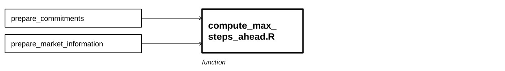

# compute_max_steps_ahead.R

**Function** &nbsp;·&nbsp; `30_Simulation/03_Functions/compute_max_steps_ahead.R`

## Function

Works out how far ahead any market of the simulation looks, as a number of market-resolution steps. It is the width of the price matrices and of the market commitment matrices: one column per step ahead of a market event. The distance of a market is measured from its bid time to the end of its optimization horizon, and it is read from the market configuration that the simulation actually uses:

- Basic mode (Complex_Market_Config = "no"): the Scheduling and the Piloting market of 03_Market_config.csv. hours = Anticipation + Optimization_horizon
- Complex mode (Complex_Market_Config = "yes"): every market of 04_Market_config_scheduling.csv and 05_Market_config_piloting.csv. hours = closure + end + end_optimization

The largest distance found is turned into steps of market_resolution, rounded up, so that a horizon that is not an exact multiple of the resolution still gets a column for its last partial step.

## Called by

- [prepare_commitments.R](prepare_commitments.md)
- [prepare_market_information.R](prepare_market_information.md)

## What it calls, in order of appearance

- Nothing: this piece calls no other piece of the project.

## Input data

- market                   : List, parameters$market. Uses:
    - market_resolution (min)
    - Complex_Market_Config ("yes"/"no")
    - Anticipation_scheduling, Optimization_horizon_scheduling, Anticipation_piloting and Optimization_horizon_piloting (h), in basic mode
- market_config_scheduling : data frame, parameters$market_config_scheduling. Closure, end and end_optimization [h] of each market, in complex mode.
- market_config_piloting   : data frame, parameters$market_config_piloting. The same columns, in complex mode.

## Output data

- Integer scalar. The number of market-resolution steps ahead.

## Other notes from the file header

### Code outline

1. Distance of the furthest market, in hours
2. Conversion to market-resolution steps

### Usage instructions

```r
max_steps_ahead <- compute_max_steps_ahead(
  market                   = parameters$market,
  market_config_scheduling = parameters$market_config_scheduling,
  market_config_piloting   = parameters$market_config_piloting
  )
```

## Diagram



Also available as [compute_max_steps_ahead.svg](compute_max_steps_ahead.svg).

---

[Back to the code structure index](../Code_Structure.md)
