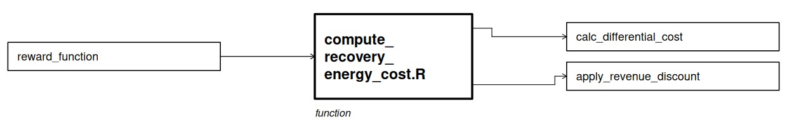

# compute_recovery_energy_cost.R

**Function** &nbsp;·&nbsp; `30_Simulation/03_Functions/compute_recovery_energy_cost.R`

## Function

Values the energy a flexibility event would move during its Recovery Phase, weighted by the probability that the event is actually called, for one leg of the service.
Every row of the window is valued, inside the market horizon or not The energy the building moves while recovering is bought or sold whenever it happens. A flexibility window is longer than the stretch of time a single market trades, so part of it falls beyond that market's target intervals; valuing only the part inside would leave a real cost of executing the service unseen, and would make the reward depend on where the window happens to fall relative to the market grid. Every Recovery Phase row is therefore valued, with the market's prices where the market has a view and with the row's own prices where it does not. That second case reads the true future prices rather than a forecast, which is a known limitation of the model - see the Known Issues section of README.md.

The baseline is the plan, not the market position The deviation is measured against the building's own plan, not against what was committed in an earlier market. This is a conditional scenario - "if I am called, my profile would be this one instead of that one" - rather than a change of commitment towards the market. Being a differential against the plan, it does not double count with the base-energy term of the reward, which values Elec_total_plan against the previous commitment.

## Called by

- [reward_function.R](reward_function.md)

## What it calls, in order of appearance

- [calc_differential_cost.R](calc_differential_cost.md)
- [apply_revenue_discount.R](apply_revenue_discount.md)

## Input data

- E_plan              : Numeric vector. Per-timestep electricity of the baseline itinerary (Elec_total_plan), kWh.
- E_flex              : Numeric vector, same length. Per-timestep electricity of the flexibility itinerary of this leg (Elec_total_plan_flex_down or Elec_total_plan_flex_up), kWh.
- phase               : Numeric/integer vector, same length. Phase code of each timestep for this leg (Flex_phase_down_plan or Flex_phase_up_plan). Only the rows of phase 3 are valued.
- MarketUTC_candidate : POSIXct vector, same length. Market interval of each timestep.
- market_utc          : POSIXct vector. Target market intervals, in the order matching every *_by_market argument (as returned by resolve_marginal_context()).
- P_import_buy_by_market, P_import_sell_by_market, P_export_buy_by_market, P_export_sell_by_market : Numeric vectors, same length/order as market_utc. Energy prices of each target interval.
- probability_by_market : Numeric vector in [0, 1], same length/order as market_utc. Activation probability of this leg in each target interval.
- P_import_buy_row, P_import_sell_row, P_export_buy_row, P_export_sell_row : Numeric vectors, same length as E_plan. Energy prices of every timestep, read from the period_chunk itself. They are what the Recovery Phase rows that fall outside the market's target intervals are valued with.
- probability_row     : Numeric vector in [0, 1], same length as E_plan. Activation probability of this leg at every timestep, for the same rows.
- discount_by_market  : Numeric vector, same length/order as market_utc. Revenue discount factor of each target interval, as returned by revenue_discount_factor().
- discount_row        : Numeric vector, same length as E_plan. The same factor at every timestep, used for the Recovery Phase rows that fall outside the market's target intervals. Both are needed for the same reason the prices are: this term reaches beyond the market's horizon, and every interval it values has to be discounted by its own distance from the decision instant.

## Output data

- Numeric scalar. Expected cash flow of the Recovery Phase deviation across every target interval, with the repository's sign convention:
- income positive, expense negative, and the income of each interval discounted by its own factor.

## Other notes from the file header

### Why this term exists

Executing a flexibility commitment is not free for the building. Once the event and the recovery are over, the thermostat takes over again and the building spends the Recovery Phase returning to the state it would have been in, buying or selling energy it had not planned to. That deviation was not valued anywhere: the effective flexibility price bundles the commitment payment with the expected execution payment into a single number and says nothing about energy. Only the Recovery Phase is valued, and not by convention: the Commitment Phase's own energy is assumed to be already remunerated by the execution price, and during the Neutral Phase the deviation is exactly zero by construction. The Neutral Phase is simulated in calculation_mode 2, which reads the power of every step from the Q_* columns, and those columns still hold the copy of the _plan itinerary that initialize_plan_flex_columns() made, since the flexibility evaluation only overwrites the rows of the Commitment Phase. As the simulation loop derives electricity from Q and the outdoor temperature alone, the flexibility itinerary and the plan spend exactly the same in every Neutral Phase row.

### Code outline

1. Market intervals holding a Recovery Phase row
2. Prices and probability of each of those intervals
3. Aggregate the two itineraries over the Recovery Phase rows
4. Value the deviation of each interval, weight it by probability and discount its income

### Usage instructions

```r
dC_recov <- compute_recovery_energy_cost(E_plan, E_flex, phase,
  MarketUTC_candidate, market_utc, P_import_buy_by_market,
  P_import_sell_by_market, P_export_buy_by_market,
  P_export_sell_by_market, probability_by_market,
  P_import_buy_row, P_import_sell_row, P_export_buy_row,
  P_export_sell_row, probability_row)
```

### Exceptions and special cases

- The result is exactly 0 for a leg that placed no window at all: with no phase-3 row there is nothing to value, and the function returns before doing any work.
- An interval whose activation probability is 0 contributes 0, which is correct: a service that will not be called costs nothing to execute.
- Only the intervals that actually hold a Recovery Phase row are valued; the target intervals of the market that hold none do not enter the sum at all.

## Diagram



Also available as [compute_recovery_energy_cost.svg](compute_recovery_energy_cost.svg).

---

[Back to the code structure index](../Code_Structure.md)
