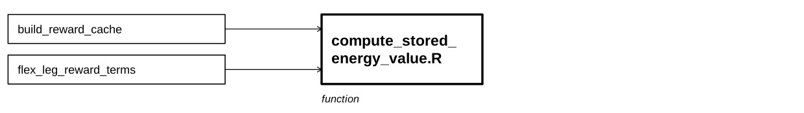

# compute_stored_energy_value.R

**Function** &nbsp;·&nbsp; `30_Simulation/03_Functions/compute_stored_energy_value.R`

## Function

Values the energy the assets of the system leave stored, at the mean price at which the market buys energy over its horizon:

- V = price * sum_k probability_k * stored_change_k

stored_change_k is the change of the energy stored on row k, on the side of the system (system_stored_energy()), positive when energy is stored, and probability_k the weight of the row. The value is positive when energy is stored, and negative when stored energy is given up: stored energy is worth what it saves to buy. It is the plain value, in EUR: the revenue discount and the difference with what was committed are applied by economic_terms().

## Called by

- [build_reward_cache.R](build_reward_cache.md)
- [flex_leg_reward_terms.R](flex_leg_reward_terms.md)

## What it calls, in order of appearance

- Nothing: this piece calls no other piece of the project.

## Input data

- stored_change : Numeric vector. Change of the stored energy of each row (kWh, positive when stored).
- probability   : Numeric vector, as long as stored_change. Weight of each row: 1 for the plan, and the activation probability of the leg for a flexibility itinerary.
- price         : Numeric scalar (EUR/kWh). Mean price at which the market buys energy over its horizon.

## Output data

- Numeric scalar (EUR). The run stops if the lengths differ, if a value is missing or if the price is not finite.

## Other notes from the file header

### Code outline

1. Check the inputs
2. Value the stored energy

### Usage instructions

```r
value <- compute_stored_energy_value(
  stored_change = stored_energy$plan,
  probability   = rep(1, length(stored_energy$plan)),
  price         = marginal_context$stored_energy_price
  )
```

## Diagram



Also available as [compute_stored_energy_value.svg](compute_stored_energy_value.svg).

---

[Back to the code structure index](../Code_Structure.md)
