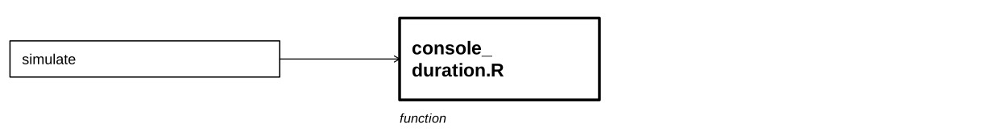

# console_duration.R

**Function** &nbsp;·&nbsp; `30_Simulation/03_Functions/console_duration.R`

## Function

Formats a duration in seconds as h:mm:ss, for the elapsed and the remaining time written in the console.

## Called by

- [simulate.R](simulate.md)

## What it calls, in order of appearance

- Nothing: this piece calls no other piece of the project.

## Input data

- seconds : Numeric. Duration in seconds.

## Output data

- Character. The duration as "h:mm:ss", rounded to the second.

## Other notes from the file header

### Code outline

1. Split into hours, minutes and seconds

### Usage instructions

console_duration(3725)  # "1:02:05"

## Diagram

Also available as [console_duration.svg](console_duration.svg).

---

[Back to the code structure index](../Code_Structure.md)
