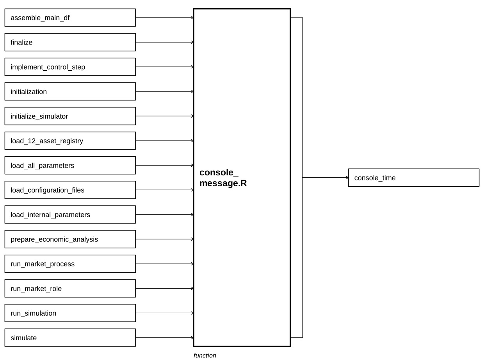

# console_message.R

**Function** &nbsp;·&nbsp; `30_Simulation/03_Functions/console_message.R`

## Function

Writes one line of the console. Every message of the simulation goes through it, so that the lines of a run are aligned. A line has three columns:

- the label, the kind of the message, padded to the width of the longest label
- the instant of the simulation the message refers to, as console_time() writes it, or blanks of the same width when the message has no instant
- the text

The labels are LOAD, DATA, PREPARE, RUN, MARKET, TRANSFER and WARNING. The width of each column follows from the labels and from the format of the instant, so no width is written anywhere else. It writes lines only. A warning of the simulation is still raised with warning(), and an error with stop().

## Called by

- [assemble_main_df.R](assemble_main_df.md)
- [finalize.R](finalize.md)
- [implement_control_step.R](implement_control_step.md)
- [initialization.R](initialization.md)
- [initialize_simulator.R](initialize_simulator.md)
- [load_12_asset_registry.R](load_12_asset_registry.md)
- [load_all_parameters.R](load_all_parameters.md)
- [load_configuration_files.R](load_configuration_files.md)
- [load_internal_parameters.R](load_internal_parameters.md)
- [prepare_economic_analysis.R](prepare_economic_analysis.md)
- [run_market_process.R](run_market_process.md)
- [run_market_role.R](run_market_role.md)
- [run_simulation.R](run_simulation.md)
- [simulate.R](simulate.md)

## What it calls, in order of appearance

- [console_time.R](console_time.md) &nbsp;(2 call sites)

## Input data

- label : Character. One of the labels listed above.
- text  : Character. The text of the line.
- time  : POSIXct of length 1, or NULL. The instant of the line.

## Output data

- None. The line is written to the console.

## Other notes from the file header

### Code outline

1. Labels and widths
2. Check
3. Write the line

### Usage instructions

```r
console_message(
  label = "RUN",
  text  = "Simulation of 1000 steps",
  time  = Main_df$time[1]
  )
```

## Diagram



Also available as [console_message.svg](console_message.svg).

---

[Back to the code structure index](../Code_Structure.md)
