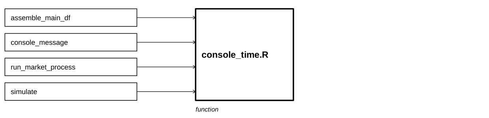

# console_time.R

**Function** &nbsp;·&nbsp; `30_Simulation/03_Functions/console_time.R`

## Function

Formats an instant of the simulation for the console. Every instant is written with the same format, the hour included also at midnight, so that the columns of the console keep their width. console_message() writes its instant column with it, and the messages that quote an instant in their text use it too.

## Called by

- [assemble_main_df.R](assemble_main_df.md)
- [console_message.R](console_message.md)
- [run_market_process.R](run_market_process.md)
- [simulate.R](simulate.md)

## What it calls, in order of appearance

- Nothing: this piece calls no other piece of the project.

## Input data

- x : POSIXct vector, or NULL. A character vector that writes instants is accepted too, and read as written.

## Output data

- Character vector, one element per instant, as "YYYY-MM-DD hh:mm:ss". NULL for NULL.

## Other notes from the file header

### Code outline

1. Format

### Usage instructions

```r
console_time(Main_df$time[1])
```

## Diagram



Also available as [console_time.svg](console_time.svg).

---

[Back to the code structure index](../Code_Structure.md)
