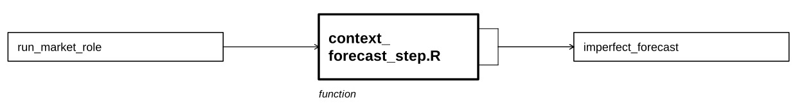

# context_forecast_step.R

**Function** &nbsp;·&nbsp; `30_Simulation/03_Functions/context_forecast_step.R`

## Function

This function extracts or generates a fake forecast context for a given optimization horizon.

It returns a data frame containing only the time, external temperature forecast (Text_forec), solar radiation forecast (SolarR_forec) and mean outdoor temperature of the plan (T_ext_24h_forec) columns for the requested horizon window. T_ext_24h_forec is what the plan knows of T_ext_24h when the market clears: the T_ext_24h of the bid time row i0, which is the mean measured Text of the day before the date of the clearing. It is held constant over the whole window, so the plan never reads the temperature of a day that has not ended yet. It is the same with both forecast types. When an inaccurate forecast type is requested, the function calls imperfect_forecast() to blend ground-truth values with a historical average, introducing realistic forecast uncertainty.

The forecast consists of a weighted average beween the actual climate and a historical average, with the weight of the historical average increasing linearly along the horizon. This allows to introduce realistic forecast uncertainty in the building performance predictions.

## Called by

- [run_market_role.R](run_market_role.md)

## What it calls, in order of appearance

- [imperfect_forecast.R](imperfect_forecast.md) &nbsp;(2 call sites)

## Input data

- simulation_control : Named list. Must contain simulation_control$indexes_global$i0 (Integer. Index of the bid time of the market in Main_df) and simulation_control$indexes_global$i_end_horizon (Integer. Index of the last step of the forecast horizon in Main_df).
- time_sec         : Numeric vector. Time in seconds (currently unused internally but kept for interface consistency).
- Main_df          : Data frame. Full simulation time series containing at least the columns 'time', 'Text', 'SolarR' and 'T_ext_24h'.
- parameters       : List. Model/forecast parameters. Must contain a sub-list 'forecast_parameters' with fields: weather_forecast_type           : Character. Either "accurate" or "inaccurate". weather_forecast_n_days_back    : Integer. Days of history. Required with "inaccurate". weather_forecast_weight_history : Numeric. Weight of the history one day ahead. Required with "inaccurate". Also requires: debug_and_config_parameters$verbose: Logical. Read into a local variable but not currently used (no progress messages are printed).

## Output data

- A named list with two elements: forecast_df : Data frame with columns: time         – POSIXct timestamps Text_forec   – Forecast of external air temperature (°C) SolarR_forec – Forecast of solar radiation (W/m²) T_ext_24h_forec – Mean outdoor temperature the plan reads (°C), T_ext_24h at i0 on every row Rows span from index i0 to i_end_horizon in Main_df. no_history  : Integer. Number of instants of the horizon that found no history in the inaccurate forecast of Text and of SolarR, added up. 0 for an accurate forecast.

## Other notes from the file header

### Code outline

1. Extract forecast parameters
2. Select forecast method (accurate or inaccurate)
3. Generate forecast data frame
4. Return forecast results

### Usage instructions

```r
result <- context_forecast_step(simulation_control, time_sec, Main_df,
  parameters)
```

### Exceptions and special cases

- If weather_forecast_type == "inaccurate" and imperfect_forecast() returns no matching timestamps, the corresponding forecast column retains the ground-truth value (fallback to accurate forecast).
- If weather_forecast_type == "inaccurate" and weather_forecast_n_days_back or weather_forecast_weight_history is missing from parameters$forecast, the function stops with an error message. It holds no fallback value for them.
- If all predicted values are NA (e.g., at the very start of the series where no historical days exist), the original ground-truth values are kept unchanged.

## Diagram



Also available as [context_forecast_step.svg](context_forecast_step.svg).

---

[Back to the code structure index](../Code_Structure.md)
