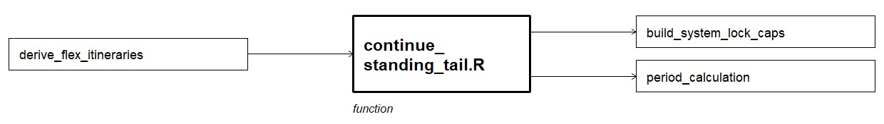

# continue_standing_tail.R

**Function** &nbsp;·&nbsp; `30_Simulation/03_Functions/continue_standing_tail.R`

## Function

Continues, over the plan of a chunk, the tail of a flexibility window whose Commitment Phase ended before the chunk starts. Only its Neutral and Recovery Phases are left, and they are simulated here from the state the window left at the first row of the chunk.
Why the tail is simulated again and not copied In the Neutral Phase the power of every step is imposed from the plan, so the flexibility itinerary spends exactly what the plan spends. The plan of the chunk is not the plan the window was built over: the chunk simulates it again, and a market that optimizes energy changes it with every candidate. A tail copied from the earlier plan would stop spending what the current plan spends, and the difference would show up as a flexibility the window never sold. Continuing the tail over the current plan keeps the Neutral Phase neutral, and the Recovery Phase starts from the state the window actually left.

## Called by

- [derive_flex_itineraries.R](derive_flex_itineraries.md)

## What it calls, in order of appearance

- [build_system_lock_caps.R](build_system_lock_caps.md)
- [period_calculation.R](period_calculation.md)

## Input data

- period_chunk : Data frame. The chunk being derived, with both flexibility itineraries already laid as a copy of _plan, and the state of the window written on row 1 of the flexibility columns of the leg.
- leg          : Character scalar, "down" or "up".
- tail         : Named list, as run_market_process() builds it: rows   - Integer vector. Rows of the chunk occupied by the tail. phases - Integer vector, one per row of rows. Phase code of every row: 2 Neutral, 3 Recovery. system - Character scalar, "heat", "cool" or "none". The system that provided the service, which the Recovery Phase may not replace with the other one.
- parameters   : Named list. Model parameters, passed to period_calculation().

## Output data

- The chunk with the flexibility itinerary of the leg simulated over the rows of the tail, and Flex_phase_<leg>_plan set to its phases.

## Other notes from the file header

### Code outline

1. The rows to simulate and their phases
2. Simulate the tail

### Usage instructions

```r
period_chunk <- continue_standing_tail(period_chunk, "down", tail, parameters)
```

### Exceptions and special cases

- Row 1 is the initial state of the simulation and is never simulated: it keeps the state of the window handed over by the caller.
- The Neutral Phase is simulated with the power imposed (calculation_mode 2), read from the flexibility columns, which are the copy of the plan. The Recovery Phase is simulated with the setpoints and the caps of build_system_lock_caps() (calculation_mode 3), except its first row, which keeps the imposed power, as in flex_evaluation_down() and flex_evaluation_up(). A tail continued over the same plan is therefore the same itinerary the builder drew.

## Diagram



Also available as [continue_standing_tail.svg](continue_standing_tail.svg).

---

[Back to the code structure index](../Code_Structure.md)
