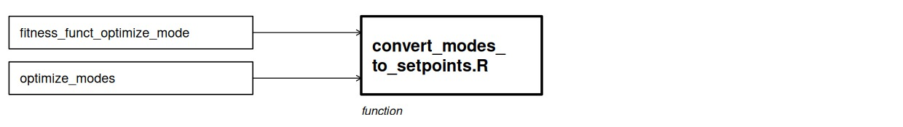

# convert_modes_to_setpoints.R

**Function** &nbsp;·&nbsp; `30_Simulation/03_Functions/convert_modes_to_setpoints.R`

## Function

HVAC modes are used to define heating and cooling setpoints. This function performs a conversion from modes to setpoints. When more than one mode is active, the one with the highest value is selected. Once the setpoints are defined, this function converts high-level setpoints to low-level setpoints with hysteresis deadbands. Length correction is also performed.

## Called by

- [fitness_funct_optimize_mode.R](fitness_funct_optimize_mode.md)
- [optimize_modes.R](optimize_modes.md)

## What it calls, in order of appearance

- Nothing: this piece calls no other piece of the project.

## Input data

- setpoint_modes_df : Data frame. Time series defining which mode 'maxmode' is active in each timestep. Must contain columns: period  – POSIXct. Market period timestamps. maxmode – Integer. Active mode index per period.
- setpoint_modes    : Data frame. Lookup table mapping mode indices to heating and cooling setpoint values. Must contain: mode    – Integer. Mode index. heating – Numeric. Heating setpoint (°C). cooling – Numeric. Cooling setpoint (°C).
- Deadband          : Numeric scalar. Deadband width for the hysteresis thermostat. Applied symmetrically: STP_xxx_low  = STP_xxx - Deadband/2 STP_xxx_high = STP_xxx + Deadband/2
- target_periods    : POSIXct vector. Market period timestamps for length correction. Not strictly required, but needed for index compatibility.
- pad_mode          : Integer scalar. Padding mode index for periods beyond the input length. Default: 0.
- pad_heating       : Numeric scalar. Padding heating setpoint. Has no default: the caller passes parameters$control$pad_heating.
- pad_cooling       : Numeric scalar. Padding cooling setpoint. Has no default: the caller passes parameters$control$pad_cooling.

## Output data

- Data frame (df) with columns: period        – POSIXct. Market period timestamps. mode          – Integer. Active mode index per period. STP_heat      – Numeric. Heating setpoint. STP_cool      – Numeric. Cooling setpoint. STP_heat_low  – Numeric. Heating activation threshold (lower). STP_heat_high – Numeric. Heating deactivation threshold (upper). STP_cool_low  – Numeric. Cooling activation threshold (lower). STP_cool_high – Numeric. Cooling deactivation threshold (upper).

## Other notes from the file header

### Code outline

1. Validate mode/setpoint inputs
2. Look up setpoint values for each mode from setpoint_modes table
3. Apply deadband offsets
4. Build output data frame with per-period setpoints

### Usage instructions

```r
sp_df <- convert_modes_to_setpoints(setpoint_modes_df = maxmode_result,
  setpoint_modes = parameters$setpoint_modes,
  Deadband = parameters$control$Deadband,
  target_periods = timestamps$target_periods)
```

### Exceptions and special cases

- If target_periods is NULL, the output data frame is built directly from the merged result without length adjustment.
- If n_setpoints >= n_periods, the output is trimmed to n_periods rows.
- If n_setpoints < n_periods, the output is padded using pad_mode, pad_heating, and pad_cooling for the missing timesteps.
- Deadband is applied symmetrically (see above).
- If a requested mode does not exist in setpoint_modes, the function stops with an error so the simulation does not continue with missing setpoints.

## Diagram



Also available as [convert_modes_to_setpoints.svg](convert_modes_to_setpoints.svg).

---

[Back to the code structure index](../Code_Structure.md)
