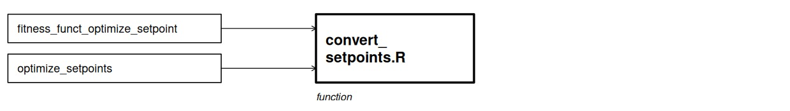

# convert_setpoints.R

**Function** &nbsp;·&nbsp; `30_Simulation/03_Functions/convert_setpoints.R`

## Function

This function converts high-level setpoints to low-level setpoints with hysteresis deadbands. Length correction is also performed.

## Called by

- [fitness_funct_optimize_setpoint.R](fitness_funct_optimize_setpoint.md)
- [optimize_setpoints.R](optimize_setpoints.md)

## What it calls, in order of appearance

- Nothing: this piece calls no other piece of the project.

## Input data

- setpoints_heating : Numeric vector. Heating setpoints for each period.
- setpoints_cooling : Numeric vector. Cooling setpoints for each period.
- Deadband          : Numeric scalar. Deadband width for the hysteresis thermostat. Default: 1. Applied symmetrically: STP_xxx_low  = STP_xxx - Deadband/2 STP_xxx_high = STP_xxx + Deadband/2
- target_periods    : POSIXct vector. Market period timestamps used to define the output length. Not strictly required, but needed for index compatibility.
- pad_heating       : Numeric scalar. Padding value applied to heating setpoints for periods beyond the input length. Has no default: the caller passes parameters$control$pad_heating.
- pad_cooling       : Numeric scalar. Padding value applied to cooling setpoints for periods beyond the input length. Has no default: the caller passes parameters$control$pad_cooling.

## Output data

- Data frame (df) with columns: period        – POSIXct. Market period timestamps. STP_heat      – Numeric. Heating setpoint. STP_cool      – Numeric. Cooling setpoint. STP_heat_low  – Numeric. Heating activation threshold (lower). STP_heat_high – Numeric. Heating deactivation threshold (upper). STP_cool_low  – Numeric. Cooling activation threshold (lower). STP_cool_high – Numeric. Cooling deactivation threshold (upper).

## Other notes from the file header

### Code outline

1. Generate setpoint schedule from heating/cooling temperature vectors
2. Align with market period timestamps
3. Return data frame with period and setpoint columns

### Usage instructions

```r
sp_df <- convert_setpoints(setpoints_heating = heat_set,
  setpoints_cooling = cool_set,
  Deadband = parameters$control$Deadband,
  target_periods = timestamps$target_periods)
```

### Exceptions and special cases

- If n_setpoints >= n_hours, the heating and cooling vectors are trimmed to the first n_hours values.
- If n_setpoints < n_hours, the heating and cooling vectors are padded using pad_heating and pad_cooling respectively for the missing periods.
- If target_periods is NULL, n_hours will be 0 and the output data frame will have no rows; callers should ensure target_periods is provided.

## Diagram



Also available as [convert_setpoints.svg](convert_setpoints.svg).

---

[Back to the code structure index](../Code_Structure.md)
