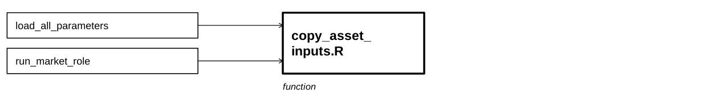

# copy_asset_inputs.R

**Function** &nbsp;·&nbsp; `30_Simulation/03_Functions/copy_asset_inputs.R`

## Function

Copies into the table of each asset the columns of Main_df that the type of the asset declares as inputs (stage input in 02_Needed_cols.csv, parameters$asset_input_cols). The table of an asset holds its inputs during the whole run, with the same values as Main_df on every row, so the models read their inputs from their own table. There are two ways to copy:

- the whole column (rows = NULL): the column is created in the table of the asset as a real copy, never as the same vector that Main_df holds, so a later write into one table can never reach the other. The tables are still data frames;
- some rows (rows given): the values of those rows are written into the columns the tables already hold, by reference. The tables are data tables.

A type with no inputs takes nothing from any copy, and the function then changes no table.
<https://github.com/robgaray/Model-Predictive-Control-in-Buildings>

## Called by

- [load_all_parameters.R](load_all_parameters.md)
- [run_market_role.R](run_market_role.md)

## What it calls, in order of appearance

- Nothing: this piece calls no other piece of the project.

## Input data

- Main_df    : Data frame or data table. The table the inputs are taken from.
- assets     : Named list, one entry per asset, each with df, the table of the asset.
- parameters : List. It holds the type of each asset (parameters$assets[[asset_id]]$asset_type) and the inputs of each type (parameters$asset_input_cols).
- rows       : Integer vector, or NULL. The rows to copy, or NULL for the whole column.
- columns    : Character vector. The columns to copy. Each asset takes those of them that its type declares as inputs.

## Output data

- The list assets, with the copied columns in the table of each asset. With rows given the tables are written by reference too.

## Other notes from the file header

### Code outline

1. Copy the inputs into the table of each asset

### Usage instructions

```r
assets <- copy_asset_inputs(
  Main_df    = Main_df,
  assets     = assets,
  parameters = parameters,
  rows       = NULL,
  columns    = unique(unlist(parameters$asset_input_cols))
  )
```

### Exceptions and special cases

- An input that Main_df does not hold, or, with rows given, that the table of the asset does not hold, stops the run.

## Diagram



Also available as [copy_asset_inputs.svg](copy_asset_inputs.svg).

---

[Back to the code structure index](../Code_Structure.md)
