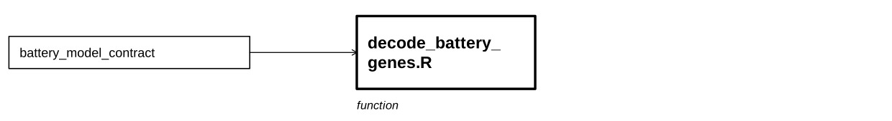

# decode_battery_genes.R

**Function** &nbsp;·&nbsp; `30_Simulation/05_Models/03_Battery/03_Functions/decode_battery_genes.R`

## Function

Turns the genes of a battery into its control: one mode per market interval, a whole number from 1 to the number of modes of battery_modes(), becomes a table with the start of the interval and its mode. It is the operation decode_genes of the type Battery (see model_type_contract()). The table is the one battery_simulate_itinerary() reads as set_point_df.

## Called by

- [battery_model_contract.R](battery_model_contract.md)

## What it calls, in order of appearance

- Nothing: this piece calls no other piece of the project.

## Input data

- genes          : Integer vector, one mode per market interval of the horizon, from 1 to gene_options.
- gene_options   : Integer scalar. Number of modes, as the operation gene_options of the battery gives it.
- target_periods : POSIXct vector. Start of each market interval of the horizon, one per gene.
- parameters     : Named list of the parameters of the simulation. It is not read: a battery needs none to decode its genes.
- asset          : Named list. The parameters of the battery, its entry of parameters$assets. It is not read.

## Output data

- Data frame, one row per market interval, with the columns:
    - period: the start of the interval
    - Mode: the mode of the interval, an integer

## Other notes from the file header

### Code outline

1. Check the genes
2. Pair each gene with its market interval

### Usage instructions

```r
control <- decode_battery_genes(
  genes          = x,
  gene_options   = 5L,
  target_periods = timestamps$target_periods,
  parameters     = parameters,
  asset          = asset
  )
```

## Diagram



Also available as [decode_battery_genes.svg](decode_battery_genes.svg).

---

[Back to the code structure index](../Code_Structure.md)
