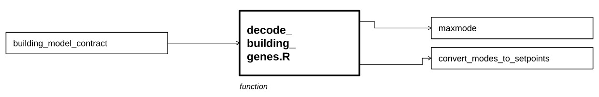

# decode_building_genes.R

**Function** &nbsp;·&nbsp; `30_Simulation/05_Models/01_Building/03_Functions/decode_building_genes.R`

## Function

Turns the genes of a building into its control: one setpoint mode per market interval becomes the heating and cooling setpoints of each interval, with their hysteresis deadbands. It is the operation decode_genes of the type Building (see model_type_contract()).

## Called by

- [building_model_contract.R](building_model_contract.md)

## What it calls, in order of appearance

- [maxmode.R](maxmode.md)
- [convert_modes_to_setpoints.R](convert_modes_to_setpoints.md)

## Input data

- genes          : Integer vector, one mode index per market interval of the horizon, from 1 to gene_options.
- gene_options   : Integer scalar. Number of setpoint modes, as building_gene_options() gives it.
- target_periods : POSIXct vector. Start of each market interval of the horizon, one per gene.
- parameters     : Named list. The parameters of the system. Not read: every interval of the horizon has a gene.
- asset          : Named list. The parameters of the building, its entry of parameters$assets. Must contain setpoint_modes, the data frame of the modes, and control$Deadband, the width of the hysteresis band [degC].

## Output data

- Data frame, one row per market interval, as convert_modes_to_setpoints() returns it:
    - period
    - STP_heat, STP_heat_low, STP_heat_high
    - STP_cool, STP_cool_low, STP_cool_high

## Other notes from the file header

### Code outline

1. Pair each gene with its market interval
2. Convert the modes to setpoints

### Usage instructions

```r
set_point_df <- decode_building_genes(
  genes          = x,
  gene_options   = n_modes,
  target_periods = timestamps$target_periods,
  parameters     = parameters,
  asset          = asset
  )
```

## Diagram



Also available as [decode_building_genes.svg](decode_building_genes.svg).

---

[Back to the code structure index](../Code_Structure.md)
