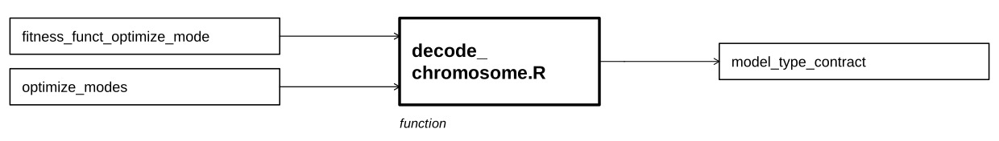

# decode_chromosome.R

**Function** &nbsp;·&nbsp; `30_Simulation/03_Functions/decode_chromosome.R`

## Function

Turns a chromosome of the genetic algorithm into the control of each asset over the horizon. The chromosome is made of one block per asset with genes, as chromosome_layout() lays it out. Each block is handed to the operation decode_genes of the type of model of its asset (model_type_contract()), which turns its genes, one per market interval, into the control table of the asset: for a Building, the setpoints of each market interval with their deadbands.
<https://github.com/robgaray/Model-Predictive-Control-in-Buildings>

## Called by

- [fitness_funct_optimize_mode.R](fitness_funct_optimize_mode.md)
- [optimize_modes.R](optimize_modes.md)

## What it calls, in order of appearance

- [model_type_contract.R](model_type_contract.md)

## Input data

- x              : Integer vector, the chromosome, of length layout$n_genes.
- layout         : Named list, as chromosome_layout() returns it. Its blocks give the asset of each block, the number of options of its genes and the positions of its first and last genes.
- target_periods : POSIXct vector. Start of each market interval of the horizon, one per gene of each block.
- parameters     : Named list. Must contain parameters$assets, the asset registry, and what the operation decode_genes of each type reads (for a Building: control$pad_heating and control$pad_cooling).

## Output data

- Named list, one element per asset with genes, named by its asset_id: the control table of the asset, one row per market interval, as the operation decode_genes of its type returns it.

## Other notes from the file header

### Code outline

1. Check the chromosome against the layout
2. Decode each block with the model of its asset

### Usage instructions

```r
controls <- decode_chromosome(
  x              = x,
  layout         = layout,
  target_periods = timestamps$target_periods,
  parameters     = parameters
  )
```

## Diagram



Also available as [decode_chromosome.svg](decode_chromosome.svg).

---

[Back to the code structure index](../Code_Structure.md)
