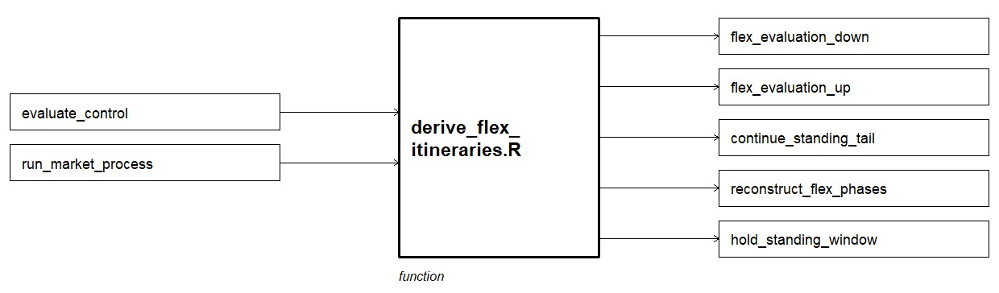

# derive_flex_itineraries.R

**Function** &nbsp;·&nbsp; `30_Simulation/03_Functions/derive_flex_itineraries.R`

## Function

Builds the two flexibility itineraries of a candidate from its own _plan itinerary AND the flexibility already committed by earlier markets, instead of throwing that commitment away.
Why the standing commitment is the starting point If both flexibility itineraries started as a copy of _plan with the commitment set to zero, every market would begin its search as if nothing had ever been sold. The reward does know about the standing commitment, because resolve_marginal_context() reads it from Main_df before optimizing, so undoing it costs money. But the ITINERARY the search works on would start at zero, so the optimizer would have to pay its way back to where it already was. On a flat optimum that is enough for the answer to flip from one market to the next, selling and rebuying the same commitment again and again. Here the standing commitment is the starting point instead.

## Called by

- [evaluate_control.R](evaluate_control.md)
- [run_market_process.R](run_market_process.md)

## What it calls, in order of appearance

- [flex_evaluation_down.R](flex_evaluation_down.md)
- [flex_evaluation_up.R](flex_evaluation_up.md)
- [continue_standing_tail.R](continue_standing_tail.md)
- [reconstruct_flex_phases.R](reconstruct_flex_phases.md)
- [hold_standing_window.R](hold_standing_window.md)

## Input data

- period_chunk       : Data frame with the _plan itinerary already simulated, and carrying the standing commitment in Elec_flex_down_plan / Elec_flex_up_plan as it came from Main_df.
- parameters         : Named list. Model and control parameters.
- simulation_control : Named list, as the window builders expect. Reads: indexes_local$i_end_control - last row of the market interval in this chunk. flexibility$restatement_mode - "guard" (default) or "projection", see above. flexibility$pre_horizon_tail - when present, one entry per leg (down, up) for a window whose Commitment Phase started before this chunk, as run_market_process() builds it: rows   - rows of this chunk it occupies. phases - its phase code on those rows. state  - one-row data frame. The state of its flexibility itinerary on row 1. system - the system that provides it.

## Output data

- Named list: period_chunk : the chunk with both flexibility itineraries built, their phases marked and the commitment they carry written in Elec_flex_down_plan / Elec_flex_up_plan. feasible     : Logical. FALSE when a window with rows in the guard zone could not be drawn because it would raise both thermal systems. The window is then held as it stands (hold_standing_window()), nothing is re-purchased, and the caller reports it.

## Other notes from the file header

### How a standing window is held over a new plan

The commitment is stored in kilowatt hours of electricity, and what the window builders take is a thermal profile. Rather than invert the electrical model - which is piecewise and underdetermined, since one electricity figure does not say how much came from each machine - this function solves for the one number the window was built from. Both flex_evaluation_down() and flex_evaluation_up() are parameterised by a flexibility fraction in (0, 1], and the electricity a window commits grows monotonically with it. So for each standing window the fraction is found by bisection, calling the repository's own builder at each step, until the electricity it commits matches what was sold. The Neutral and Recovery Phases then come out built by the same code that built them originally, with the same power caps, and over the NEW plan.

### Projection and guard zone

Every row of a Commitment Phase is restated in one of two ways, depending on where it falls, whatever the aim of the market:

- Guard zone: rows inside the market interval, from the start of the chunk to i_end_control, when the restatement mode is "guard". This market trades those rows, so the commitment margin is demanded of them. When the new plan cannot hold what was sold with the margin, the window is restated at the most the margin allows, and the difference shows up as a smaller commitment, which the economic chain books as a re-purchase. This is the only flexibility a market whose aim is operation alone ever trades.
- Projection: every other row, and every row when the restatement mode is "projection". No market trades those rows here: earlier markets did, and later markets or the execution will. The window is drawn as the new plan allows, with no margin and no judgement of its feasibility, and the commitment sold there is not changed.

A window whose Commitment Phase crosses a limit of the market interval is split: each part takes its own fraction.

### Code outline

1. Take the standing commitment and lay the baseline
2. Restate each standing window over the new plan
3. Write the commitment the itineraries carry

### Usage instructions

```r
derived <- derive_flex_itineraries(period_chunk, parameters, simulation_control)
```

### Exceptions and special cases

- With no standing commitment both itineraries are equal to _plan, with phases and commitment at zero.
- The commitment is written here, from the itineraries just drawn, with the definition reward_function() uses: the difference with the plan over the Commitment Phase. A market that places no new window, or whose aim does not value flexibility, therefore keeps the commitment it restated instead of losing it.
- Row 1 of the chunk is the initial state of the simulation and is never simulated, so it carries no commitment of its own and is left out of what each window has to reach.
- A window whose Commitment Phase ended before this chunk has only its Neutral and Recovery Phases left in it. They are continued over the plan of this chunk by continue_standing_tail(), from the state handed over on row 1.
- A window whose Commitment Phase started before this chunk and runs into it is rebuilt from row 1, where the state of its itinerary is handed over, so it continues the part the earlier stretch projected.
- The builder may refuse a window. A refusal says the builder would not draw the window here, which is no reason to throw away energy already sold: the commitment is held as it stands and the next market rebuilds it. A refusal because the window would raise both systems is also reported through feasible when the window has rows in the guard zone.
- The bisection is bounded to a fixed number of steps. It is solving one monotone scalar equation, so a few tens of steps take it far below the energy tolerance of the model.

## Diagram



Also available as [derive_flex_itineraries.svg](derive_flex_itineraries.svg).

---

[Back to the code structure index](../Code_Structure.md)
