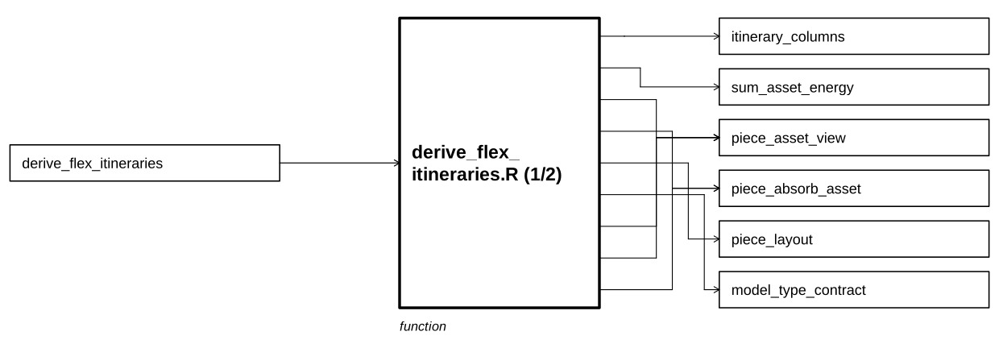

# derive_flex_itineraries.R &mdash; Called items, block 1 of 2

Block 1 of 2 of [derive_flex_itineraries.R](derive_flex_itineraries.md).

## What it calls, in this block

- [itinerary_columns.R](itinerary_columns.md)
- [sum_asset_energy.R](sum_asset_energy.md)
- [piece_asset_view.R](piece_asset_view.md)
- [piece_absorb_asset.R](piece_absorb_asset.md)
- [piece_layout.R](piece_layout.md)
- [model_type_contract.R](model_type_contract.md)

## Diagram

Also available as [derive_flex_itineraries__1.svg](derive_flex_itineraries__1.svg).

---

[Back to derive_flex_itineraries.R](derive_flex_itineraries.md) &nbsp;·&nbsp; [Back to the code structure index](../Code_Structure.md)
