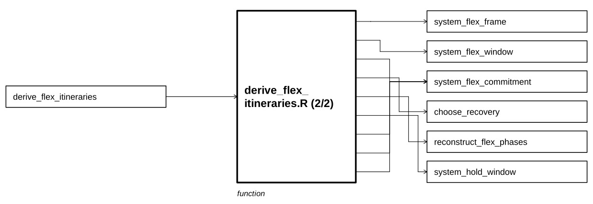

# derive_flex_itineraries.R &mdash; Called items, block 2 of 2

Block 2 of 2 of [derive_flex_itineraries.R](derive_flex_itineraries.md).

## What it calls, in this block

- [system_flex_frame.R](system_flex_frame.md)
- [system_flex_window.R](system_flex_window.md)
- [system_flex_commitment.R](system_flex_commitment.md)
- [choose_recovery.R](choose_recovery.md)
- [reconstruct_flex_phases.R](reconstruct_flex_phases.md)
- [system_hold_window.R](system_hold_window.md)

## Diagram

Also available as [derive_flex_itineraries__2.svg](derive_flex_itineraries__2.svg).

---

[Back to derive_flex_itineraries.R](derive_flex_itineraries.md) &nbsp;·&nbsp; [Back to the code structure index](../Code_Structure.md)
