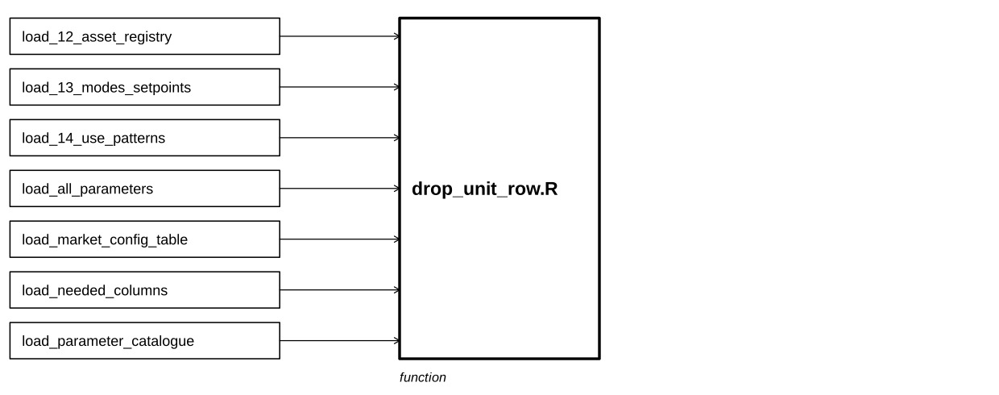

# drop_unit_row.R

**Function** &nbsp;·&nbsp; `30_Simulation/03_Functions/drop_unit_row.R`

## Function

Removes the units row of a configuration table, read as a data frame. The configuration format puts the units row right after the header, so it is the first row of the data frame, whatever it holds: "text", a unit, or "-". A file written without its units row would lose its first data row here, so the row is checked first. It has to be told apart from a data row by the columns that hold data of a known kind:

- number_columns: a data row has a number in all of them, and a units row has a unit in at least one;
- or reference_values: the values a data row may hold in reference_columns, such as the day types a month refers to; a units row holds something else in at least one of them.

When the row looks like data, the run stops: the file breaks the format, and dropping the row would silently lose data.

## Called by

- [load_12_asset_registry.R](load_12_asset_registry.md)
- [load_13_modes_setpoints.R](load_13_modes_setpoints.md)
- [load_14_use_patterns.R](load_14_use_patterns.md)
- [load_all_parameters.R](load_all_parameters.md)
- [load_market_config_table.R](load_market_config_table.md)
- [load_needed_columns.R](load_needed_columns.md)
- [load_parameter_catalogue.R](load_parameter_catalogue.md)

## What it calls, in order of appearance

- Nothing: this piece calls no other piece of the project.

## Input data

- table             : Data frame. The table, as read.csv() returns it from the file, comment rows skipped.
- file_name         : Character scalar. Name of the file, for the message.
- number_columns    : Character vector. Columns that hold numbers in a data row. May be empty when reference_columns is given.
- reference_columns : Character vector. Columns that hold one of reference_values in a data row. May be empty.
- reference_values  : Character vector. The values allowed in reference_columns.

## Output data

- The data frame without its first row.

## Other notes from the file header

### Code outline

1. Check that the first row is a units row
2. Drop it

### Usage instructions

```r
modes <- drop_unit_row(modes, "13_Modes_setpoints.csv",
  c("heating", "cooling"), character(0),
  character(0))
```

## Diagram



Also available as [drop_unit_row.svg](drop_unit_row.svg).

---

[Back to the code structure index](../Code_Structure.md)
