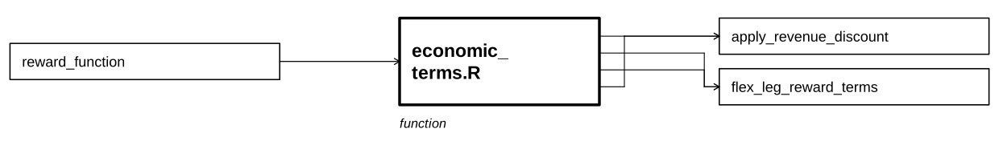

# economic_terms.R

**Function** &nbsp;·&nbsp; `30_Simulation/03_Functions/economic_terms.R`

## Function

Computes every economic term of the reward of a candidate:

- the marginal energy cost of the plan;
- the marginal distribution cost of the plan;
- the commitment revenue of each flexibility leg;
- the execution revenue of each flexibility leg, with the change of the cost of its Recovery Phase;
- when an asset stores energy, the value of the energy the plan and each leg leave stored, each as the change against the committed itineraries.

It is the system side of the reward. It works only with energy per market interval, commitments, prices and amounts: it reads the rows of system_energy_rows() (the net electricity of the system in each itinerary, the market interval and the phases of each row, the row prices and probabilities), the commitments and prices of marginal_context, the terms of the plan that reward_cache carries, and the weight alpha_cost. It never reads a temperature, a mode or a setpoint.
<https://github.com/robgaray/Model-Predictive-Control-in-Buildings>

## Called by

- [reward_function.R](reward_function.md)

## What it calls, in order of appearance

- [apply_revenue_discount.R](apply_revenue_discount.md) &nbsp;(2 call sites)
- [flex_leg_reward_terms.R](flex_leg_reward_terms.md) &nbsp;(2 call sites)

## Input data

- system_rows      : Named list, as returned by system_energy_rows() for the candidate.
- alpha_cost       : Numeric (1/EUR). Weight of every economic term.
- marginal_context : Named list, as returned by resolve_marginal_context() and completed by committed_recovery_cost(). Besides what flex_leg_reward_terms() reads, it must carry:
    - recovery_cost_committed_down
    - recovery_cost_committed_up

stop()s if they are missing. When reward_cache carries stored_value_plan, it must also carry:

- stored_value_committed_plan
- stored_value_committed_down
- stored_value_committed_up
- stored_energy_discount

and stop()s if they are missing.

- reward_cache     : Named list, as returned by build_reward_cache() for the candidate's plan. Its Elec_Cost_total and Elec_Cost_distribution_total are used, and it is handed to flex_leg_reward_terms().

## Output data

- Named list, every element a numeric vector with one value per row. Every lump-sum term is concentrated on the last row, so only its sum over the rows is meaningful:
    - Elec_Cost_plan              : marginal energy cost of the plan (EUR), plus the change of the value of the energy it leaves stored, when an asset stores energy.
    - Elec_Cost_distribution_plan : marginal distribution cost of the plan (EUR).
    - Elec_flex_down_plan         : downward commitment signal (plan - plan_flex_down), bounded to its Commitment Phase (kWh per row).
    - Elec_flex_up_plan           : upward commitment signal (plan_flex_up - plan), bounded to its Commitment Phase and to 0 from below (kWh per row).
    - Elec_flex_com_revenue_plan  : certain revenue of the commitment of both legs, at the commitment price alone (EUR).
    - Elec_flex_exec_revenue_plan : expected revenue of the execution of both legs, plus the change of the cost of their Recovery Phase against the committed itineraries, and the change of the value of the energy they leave stored, when an asset stores energy (EUR).
    - economic_reward             : alpha_cost times the sum of the four EUR terms above (dimensionless).

## Other notes from the file header

### Differential valuation

Every economic term is differential: it values only the change against what earlier markets already committed for the same market intervals, at the current market's prices (see compute_marginal_energy_cost() and resolve_marginal_context()). An itinerary identical to the committed one is valued 0, whatever the aim. The Recovery Phase is valued the same way: as the change of its expected cost against that of the itineraries already committed, which committed_recovery_cost() resolves once per market. With the "energy" aim the flexibility terms value the flexibility earlier markets sold, which the itineraries have to keep: a plan that cannot hold it buys part of it back, and the reward shows it. After the close of the control horizon the commitment cannot change: there a candidate is valued at most at the commitment that stands, so holding it is worth nothing and falling short costs the re-purchase a later market will make. The distribution cost (Elec_unit_cost_distribution) applies to the base energy only, never to flexibility. It is a decision-time-only consideration (it is never written to market_commitments, only to Reward): buying or selling energy always adds distribution cost, unbuying ("descompra") or unselling ("desventa") always reduces it, regardless of direction.

### Stored energy

An asset that stores energy (a battery) leaves, at the end of the horizon, energy that is worth what it saves to buy later. Two terms value it, both as the change against the committed itineraries, and both discounted like an income when the change is an income (apply_revenue_discount(), with the factor of the last interval of the horizon, marginal_context$stored_energy_discount):

- The energy the plan leaves stored (stored_value_plan of reward_cache) is added to Elec_Cost_plan. A candidate that leaves more energy stored than the committed plan is paid the value of the difference, and one that leaves less pays it.
- The energy each leg leaves stored against the plan, weighted by the probability that the service is called (stored_value of flex_leg_reward_terms()), is added to Elec_flex_exec_revenue_plan with the Recovery Phase cost, because it is the same conditional scenario: if the service were called and the Recovery Phase did not bring the energy back, the leg would leave it stored or spent.

They exist only when an asset stores energy. Without one, nothing is added and every term is the one it would be without them.

### Revenue discount

Income that is far away in time weighs less in the decision than the same income in the next slot. Every economic term is therefore valued per market interval and, where that interval's cash flow turns out to be an income, multiplied by (1 - Revenue_discount_per_hour/100)^n, with n the hours from the decision instant to that interval - see revenue_discount_factor() and apply_revenue_discount(). Expense is never discounted. The discount belongs to the decision and stops there. What the winning candidate is then paid is settled by settle_market() at the market's own prices, so neither the volume nor the price of any commitment carries it.

### Sign convention

Every economic term already carries the sign of its cash flow: positive = income, negative = expense (see calc_differential_cost(), compute_marginal_distribution_cost() and value_flex_operation()). The weighted economic term is therefore alpha_cost times a plain sum of the terms. The explicit-flexibility term is valued via compute_marginal_flex_revenue(), not compute_marginal_energy_cost(): explicit flexibility is a service sold to the grid in two independent down/up legs, not a single position that flips sign like energy import/export - see value_flex_operation()'s header for the full explanation of why the two cannot share the same valuation machinery.

### Code outline

1. Marginal energy and distribution cost of the plan
- 1.1. Value of the energy the plan leaves stored
2. Terms of each flexibility leg
3. Commitment and execution revenue
- 3.1. Value of the energy the legs leave stored
4. Weighted economic term

### Usage instructions

```r
economic <- economic_terms(system_rows, parameters$reward$alpha_cost,
  marginal_context, reward_cache)
```

## Diagram



Also available as [economic_terms.svg](economic_terms.svg).

---

[Back to the code structure index](../Code_Structure.md)
