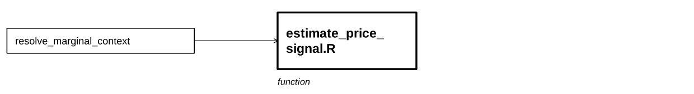

# estimate_price_signal.R

**Function** &nbsp;·&nbsp; `30_Simulation/03_Functions/estimate_price_signal.R`

## Function

Gives the price a market sees for each interval of its optimization horizon, for one price signal. Inside the control horizon it keeps the published price. Beyond it, it reads the price from the source price_estimate_sources() chose for each interval:

- an earlier market that traded the interval, or that traded the same interval one day before: the value in that market's row of the price matrix;
- this market's own price for the same interval one day before;
- the mean of this market's published prices.

## Called by

- [resolve_marginal_context.R](resolve_marginal_context.md)

## What it calls, in order of appearance

- Nothing: this piece calls no other piece of the project.

## Input data

- values    : Numeric vector, one entry per interval of the optimization horizon. The prices of this market; only those of the control horizon are read.
- signal_df : Data frame. The price matrix of the signal, one of full_market_information: a time column with the clearing interval of each market and one column per step ahead.
- sources   : Data frame, as returned by price_estimate_sources(), one row per entry of values.

## Output data

- Numeric vector, the same length as values: the price of each interval as the market sees it.

## Other notes from the file header

### Code outline

1. Check the inputs
2. Read each interval from its source

### Usage instructions

```r
P_import_buy_by_market <- estimate_price_signal(
  P_import_buy_by_market,
  full_market_information$Elec_unit_cost_import_buy_df,
  sources)
```

## Diagram



Also available as [estimate_price_signal.svg](estimate_price_signal.svg).

---

[Back to the code structure index](../Code_Structure.md)
