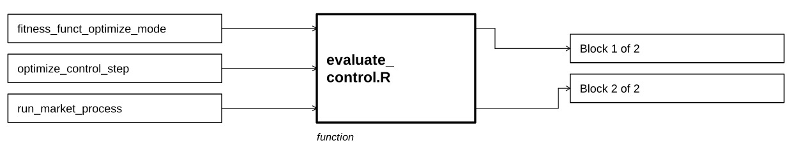

# evaluate_control.R

**Function** &nbsp;·&nbsp; `30_Simulation/03_Functions/evaluate_control.R`

## Function

This function evaluates the optimality of a control setpoint schedule over a particular period. This is a generic wrapper function that allows to integrate an optimizer with the simulation of the building. The building is simulated through the operation simulate_itinerary of its type of model (model_type_contract(); period_calculation() for a Building). The function works on the piece of a market: each asset is simulated in its view of the piece, and its plan goes back into its table. The derivation of the itineraries and the reward work on the piece too. The search for flexibility windows asks each asset in its view whether it has something to offer, and builds each candidate window on the piece, through system_flex_window(), which hands back a new piece with the window and never modifies the piece it receives. The reward of the candidate is computed on that new piece. Its internal objects are removed with rm(list = ), which does not call match.call() as rm() with names does: this function runs once for every candidate of the genetic algorithm. The flexibility windows are windows of the system: system_flex_window() fixes their phases, has every asset draft its contribution through the operation window_draft of its type of model, applies the commitment margin of the set of assets, has every asset draw its contribution through the operation window_contribution, and checks the commitment of the net. It performs the following steps:

1. Simulates each asset over the period in its view, through the operation simulate_itinerary, and stores results in *_plan columns of its table. The assets that read the net electricity of the rest of the system (operation reads_rest_net) are simulated after the others (asset_simulation_order()), with the electricity of the plan of those in their view (write_rest_net()).
2. Calls derive_flex_itineraries() on the piece to build the *_plan_flex_down and *_plan_flex_up itineraries from the *_plan columns and the flexibility standing from earlier markets. When an asset offers alternatives for the Recovery Phase of a window (a battery), the valuation that chooses among them is built before (build_recovery_valuation()), and the windows standing are drawn with the alternative that has the best reward. When the evaluation receives a derivation already drawn over the same plan with the same control (derivation), it takes it instead of drawing it again: the result is the same.
3. Calls reward_function() on the piece, on the three itineraries. For the "energy" aim this is the result.
4. For "flexibility" mode, performs a parametric evaluation over all market slots of the piece as candidate flexibility event start points. Each candidate window is built on the piece by system_flex_window(), which returns a new piece with the window, and valued there. When an asset offers alternatives for the Recovery Phase of a window (a battery), the window is built with the alternative that has the best reward (build_recovery_valuation()). For each market slot:
    - Skips it if the leg's flexibility is worth nothing there (see "Value of a slot" below), or if no asset has anything to offer on the leg there (operation slot_offer)
    - Tests expanding flexibility events by adding consecutive market slots, up to commitment_phase_length_max
    - Uses flexibility = 1 (full flexibility)
    - Stops expanding at a slot where the leg's flexibility is worth nothing, or when the reward does not improve

The best reward across all candidates is returned.

## Called by

- [fitness_funct_optimize_mode.R](fitness_funct_optimize_mode.md)
- [optimize_control_step.R](optimize_control_step.md)
- [run_market_process.R](run_market_process.md)

## What it calls, in order of appearance

- [asset_simulation_order.R](asset_simulation_order.md)
- [model_type_contract.R](model_type_contract.md) &nbsp;(2 call sites)
- [piece_asset_view.R](piece_asset_view.md) &nbsp;(3 call sites)
- [write_rest_net.R](write_rest_net.md)
- [piece_absorb_asset.R](piece_absorb_asset.md)
- [build_recovery_valuation.R](build_recovery_valuation.md)
- [derive_flex_itineraries.R](derive_flex_itineraries.md)
- [reconstruct_flex_phases.R](reconstruct_flex_phases.md) &nbsp;(2 call sites)
- [reward_function.R](reward_function.md) &nbsp;(2 call sites)
- [piece_layout.R](piece_layout.md)
- [build_reward_cache.R](build_reward_cache.md)
- [system_flex_window.R](system_flex_window.md)

## Blocks

The piece calls 12 items, so it is documented in blocks:

- [Called items, block 1 of 2](evaluate_control__1.md)
- [Called items, block 2 of 2](evaluate_control__2.md)

## Input data

- piece        : List. The piece of the optimization horizon, as build_market_piece() gives it: the table of the system and the table of each asset. The plan of each asset is simulated in its view; the derivation and the reward work on the piece, and the search builds each candidate window on the piece. Together the tables must include the columns expected by period_calculation(), for example:
    - time
    - Text
    - SolarR
    - Occupancy
    - MarketUTC
    - Ti_plan
    - Te_plan
    - Act_heat_plan
    - Act_cool_plan
- controls     : Named list or NULL (default NULL). The control of each asset, named by its asset_id, as decode_chromosome() returns it. For the building, the setpoint schedule with hysteresis deadbands already applied, as returned by convert_modes_to_setpoints(). NULL keeps the setpoints its view holds.
- parameters   : Named list. Model and control parameters passed to period_calculation(), system_flex_window(), and reward_function(). Must contain: parameters$assets : The asset registry; the asset_type of each asset gives its type of model. parameters$joined_cols : The column order of the view of an asset. The flexibility search reads every asset of the registry, through the operation slot_offer. What the operation slot_offer of each asset reads: for a Building, parameters$computing$flex_energy_tol and what resolve_flex_up_hvac() reads. parameters$market$market_resolution : Numeric (minutes). Market slot duration used as the minimum Commitment Phase length step. parameters$control$commitment_phase_length_max : Numeric (hours). Longest Commitment Phase a candidate window may reach.
- simulation_control : Named list. Simulation control object. Used to pass these elements to the flexibility evaluation functions via a cloned object:
    - simulation_control$evaluation$optimization_aim : Character. "energy", "operation", "flexibility" or "operationflex".
    - simulation_control$indexes_local$i_flex
    - simulation_control$flexibility$commitment_phase_length
    - simulation_control$flexibility$flexibility
- marginal_context   : Named list or NULL (default NULL). Passed through to reward_function() (see resolve_marginal_context()). The flexibility search also reads from it, for each leg, the commitment and execution sell prices and the activation probability of every target interval:
    - p_<leg>_com_sell_by_market
    - p_<leg>_exec_sell_by_market
    - flex_probab_<leg>_by_market
- derivation         : Named list or NULL (default NULL). A derivation of the itineraries already drawn, as committed_recovery_cost() hands it back:
    - piece: the piece it was drawn over.
    - simulation_control: the control it was drawn with.
    - derived: what derive_flex_itineraries() gave.

It is used only when its piece and its control are identical to the plan simulated here and to simulation_control. NULL draws the derivation here.

## Output data

- A named list with the following elements (in this order):
- piece        : List. The piece with the plan of each asset in its table, and in the table of the system the flexibility itineraries, their phases, Standing_commitment_held_legs_plan and the 'Reward' column of the best flexibility scenario found (for "flexibility" mode), or of the plan itself (for "energy" mode). 'Reward' holds the per-row reward values as set by reward_function().
- reward       : Numeric scalar. Sum of per-row reward values in the 'Reward' column. Best reward found over all flexibility candidate market slots (for "flexibility" mode), or the direct reward from the plan (for "energy" mode).

## Other notes from the file header

### Code outline

1. Simulate the plan of each asset in its view
2. Derive the *_plan_flex_down and *_plan_flex_up itineraries from *_plan and the standing commitment, on the piece
3. Compute reward function on the piece
4. Evaluate flexibility scenarios (if optimization_aim is flexibility): phase A downward, then phase B upward; the views of the assets are laid out once before the search
5. Return the piece

### Usage instructions

```r
result <- evaluate_control(piece, controls, parameters,
  simulation_control, marginal_context,
  derivation)
```

### Exceptions and special cases

- Simulation results are stored under execution column names (no suffix) and then aliased to *_plan columns before reward_function() is called, so that reward_function() can read Comfort_plan, Elec_total_plan, etc.
- For "flexibility" mode, evaluate_control() always initializes the *_plan_flex_down and *_plan_flex_up columns before searching.
- Value of a slot: both loops skip a start slot, and stop growing a window at a slot, where the flexibility of the leg is worth nothing to the reward. That value is the effective sell price of the leg, the commitment price plus the execution price times the activation probability, read from marginal_context: the prices resolve_marginal_context() gives the market, published inside the control horizon and estimated beyond it, which are the ones the reward values the window with. A slot with only an execution price is worth something, and is searched. A slot that is not one of the target intervals of marginal_context is not valued by the reward, and is worth nothing.
- Accepted flexibility windows never overlap WITHIN a leg, and the window that is skipped over is the WHOLE one: Commitment, Neutral and Recovery. When a window whose Commitment Phase is n slots is accepted at slot i, the outer loop resumes past slot i + n + the slots the Neutral and Recovery Phases take, so a later window can neither rewrite the columns of a stretch already committed nor start while the building is still recovering. When nothing is accepted at slot i, the outer loop resumes at slot i + 1, so every start slot is tested. The outer loop is a while loop for this reason.
- Windows of DIFFERENT legs may overlap, and that is intended. The two searches run one after the other over their own set of columns, so a slot can carry a downward commitment and an upward one at the same time; physically they are two different itineraries and neither is flown unless the operator calls it.
- The two searches share one algorithm, written once and told which leg it works on. The legs differ only in two filters:
    - The value of a slot, a rule of the system: the prices that give a slot its value.
    - The offer of the assets, through the operation slot_offer of each asset. Downward, a slot is searched when some asset consumes in it, whatever the net of the system. Upward, when some asset can raise its electricity from it.
- A candidate window may close on the last market slot of the piece, but it is never accepted: system_flex_window() returns the piece untouched when the time left from i_flex to the close of the control horizon does not cover the Commitment, Neutral and Recovery Phases, and a window closing that late never does. The reward then comes back unchanged and the inner loop breaks.
- A candidate window never grows past commitment_phase_length_max. The Commitment Phase is assembled from whole market slots, so the bound is applied as floor(commitment_phase_length_max / market_slot_h) slots. When commitment_phase_length_max is shorter than one market slot no window is admissible and no flexibility is committed, because a maximum below the resolution of the market the commitment is sold on cannot be expressed on that market's grid.
- If all market slots are skipped in "flexibility" mode, the returned reward is the baseline reward without flexibility.
- commitment_phase_length and flexibility are set in simulation_control$flexibility and passed through to the flexibility evaluation functions via a cloned simulation_control_2 object.
- COMPUTATIONAL COST: for "flexibility"/"operationflex" mode, the outer loop visits each of the L unique market slots of the piece at most once (accepted windows are skipped over, not re-entered), and for each starting slot the inner while loop keeps expanding the candidate flexibility window as long as the reward keeps improving, calling system_flex_window() + reward_function() once per expansion step. With an asset that offers alternatives for the Recovery Phase, each call of system_flex_window() also draws the window with the other alternatives and values them. The expansion stops at M = floor(commitment_phase_length_max / market_slot_h) slots, so the inner loop is bounded by M rather than by the horizon: worst case is O(M) calls per starting slot and O(L * M) overall, each itself proportional to the flexibility window size via period_calculation(). This function is in turn evaluated once per GA individual per generation by optimize_control_step()/fitness_funct_optimize_mode(), so a longer optimization horizon (larger L) or a larger GA population/generation count multiplies this cost accordingly. Keep the Piloting optimization horizon and GA population/generation settings conservative for long horizons.

## Diagram



Also available as [evaluate_control.svg](evaluate_control.svg).

---

[Back to the code structure index](../Code_Structure.md)
