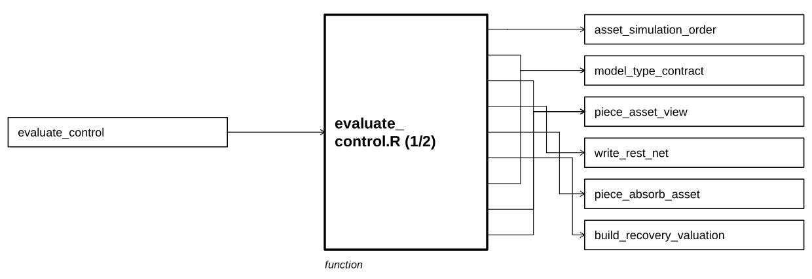

# evaluate_control.R &mdash; Called items, block 1 of 2

Block 1 of 2 of [evaluate_control.R](evaluate_control.md).

## What it calls, in this block

- [asset_simulation_order.R](asset_simulation_order.md)
- [model_type_contract.R](model_type_contract.md)
- [piece_asset_view.R](piece_asset_view.md)
- [write_rest_net.R](write_rest_net.md)
- [piece_absorb_asset.R](piece_absorb_asset.md)
- [build_recovery_valuation.R](build_recovery_valuation.md)

## Diagram

Also available as [evaluate_control__1.svg](evaluate_control__1.svg).

---

[Back to evaluate_control.R](evaluate_control.md) &nbsp;·&nbsp; [Back to the code structure index](../Code_Structure.md)
