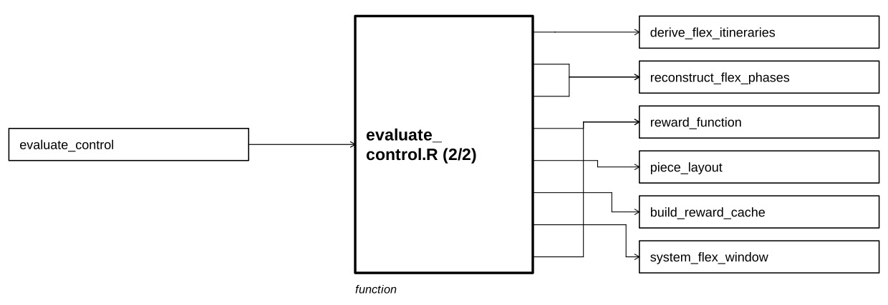

# evaluate_control.R &mdash; Called items, block 2 of 2

Block 2 of 2 of [evaluate_control.R](evaluate_control.md).

## What it calls, in this block

- [derive_flex_itineraries.R](derive_flex_itineraries.md)
- [reconstruct_flex_phases.R](reconstruct_flex_phases.md)
- [reward_function.R](reward_function.md)
- [piece_layout.R](piece_layout.md)
- [build_reward_cache.R](build_reward_cache.md)
- [system_flex_window.R](system_flex_window.md)

## Diagram

Also available as [evaluate_control__2.svg](evaluate_control__2.svg).

---

[Back to evaluate_control.R](evaluate_control.md) &nbsp;·&nbsp; [Back to the code structure index](../Code_Structure.md)
