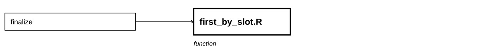

# first_by_slot.R

**Function** &nbsp;·&nbsp; `30_Simulation/03_Functions/first_by_slot.R`

## Function

Takes, for each market slot of the economic analysis, the value of a Main_df column on the first row of that slot.

Prices are a property of the market slot, not of the timestep, so the slot's own price is taken from its first row rather than aggregated. A slot with no Main_df row comes back as 0.

## Called by

- [finalize.R](finalize.md)

## What it calls, in order of appearance

- Nothing: this piece calls no other piece of the project.

## Input data

- values       : Numeric vector, one entry per row of Main_df.
- slot_group   : Numeric vector, the same length as values: the market slot of each row, as.numeric(Main_df$MarketUTC).
- slot_targets : Numeric vector: the slots of the economic analysis, as.numeric(economic_analysis$slot$time), in the order the values are wanted.

## Output data

- Numeric vector, one value per entry of slot_targets, 0 where no row belongs to the slot.

## Other notes from the file header

### Code outline

1. Take the first value of each slot, and place it on its target slot.

### Usage instructions

```r
price <- first_by_slot(Main_df$Elec_unit_cost_import_buy,
  slot_group, slot_targets)
```

## Diagram



Also available as [first_by_slot.svg](first_by_slot.svg).

---

[Back to the code structure index](../Code_Structure.md)
