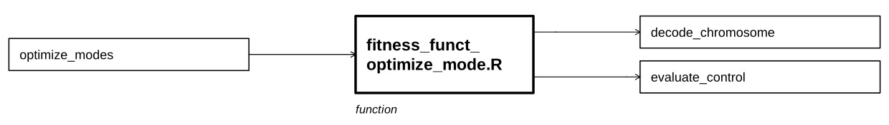

# fitness_funct_optimize_mode.R

**Function** &nbsp;·&nbsp; `30_Simulation/03_Functions/fitness_funct_optimize_mode.R`

## Function

This function is the fitness function used by the Genetic Algorithm in optimize_modes(). It decodes a chromosome, made of one block of genes per asset with genes (chromosome_layout()), into the control of each asset, through the operation decode_genes of the type of model of each asset (decode_chromosome()). For a building, its block holds one mode index per market period and becomes its setpoints. It then evaluates the simulation, and returns the resulting scalar reward.

## Called by

- [optimize_modes.R](optimize_modes.md)

## What it calls, in order of appearance

- [decode_chromosome.R](decode_chromosome.md)
- [evaluate_control.R](evaluate_control.md)

## Input data

- x            : Integer vector of length layout$n_genes, the chromosome. Each block of it holds one gene per market period for one asset: for a building, a mode index (integer value from 1 to its number of modes) representing the active mode for that market period.
- layout       : Named list. The layout of the chromosome, as chromosome_layout() returns it: the asset of each block and the positions of its genes.
- timestamps   : Named list. Timestamp metadata. Must contain: timestamps$target_periods : POSIXct vector of market period timestamps.
- parameters   : Named list. Model and control parameters. Must contain: parameters$assets : the asset registry. A building holds its setpoint_modes: Data frame mapping mode indices to setpoint values, and its control$Deadband [degC]. All other sub-elements required by evaluate_control().
- piece        : List. The piece of the optimization horizon, as passed from optimize_modes(): the table of the system and the table of each asset. Together the tables hold all columns required by period_calculation() (called inside evaluate_control()).
- simulation_control : Named list. Simulation control object passed through to evaluate_control().
- marginal_context   : Named list or NULL. Passed through to evaluate_control().

## Output data

- evaluation : Numeric scalar. Reward value extracted from evaluate_control() return list for the given mode schedule. Higher is better.

## Other notes from the file header

### A candidate that cannot be evaluated

A chromosome carrying NA is not an operation of the assets: it cannot be turned into setpoints and there is nothing to simulate. It is scored with a penalty large enough to be worse than any reachable reward, so the optimizer discards it, instead of being allowed to stop the run inside convert_modes_to_setpoints(). The chromosome should never arrive in that state - optimize_modes() sizes the elitism so that ga() cannot build one - and this is the net under that.

### Code outline

1. Decode the chromosome into the control of each asset
2. Evaluate control and compute reward

### Usage instructions

```r
fitness <- fitness_funct_optimize_mode(x, layout, timestamps,
  parameters, piece,
  simulation_control,
  marginal_context)
```

## Diagram



Also available as [fitness_funct_optimize_mode.svg](fitness_funct_optimize_mode.svg).

---

[Back to the code structure index](../Code_Structure.md)
