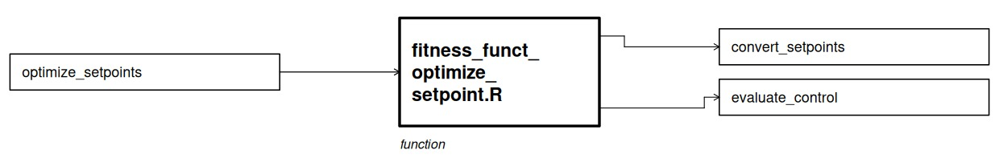

# fitness_funct_optimize_setpoint.R

**Function** &nbsp;·&nbsp; `30_Simulation/03_Functions/fitness_funct_optimize_setpoint.R`

## Function

This function is the fitness function used by the Genetic Algorithm in optimize_setpoints(). It converts a raw setpoint array produced by the GA into a structured setpoint data frame, evaluates the building simulation, and returns the resulting scalar reward.

## Called by

- [optimize_setpoints.R](optimize_setpoints.md)

## What it calls, in order of appearance

- [convert_setpoints.R](convert_setpoints.md)
- [evaluate_control.R](evaluate_control.md)

## Input data

- setpoint_array : Numeric vector. GA solution vector of length 2*horizon. The first 'horizon' elements are heating setpoints and the next 'horizon' elements are cooling setpoints.
- period_chunk   : Data frame. Simulation data for the optimization horizon, as passed from optimize_setpoints(). Must contain all columns required by period_calculation() (called inside evaluate_control()).
- parameters     : Named list. Model and control parameters. Must contain: parameters$control$Deadband All other sub-elements required by evaluate_control().
- timestamps     : Named list. Timestamp metadata. Must contain: timestamps$target_periods : POSIXct vector of market period timestamps.
- simulation_control : Named list. Simulation control object passed through to evaluate_control().
- marginal_context   : Named list or NULL. Passed through to evaluate_control().

## Output data

- evaluation : Numeric scalar. Reward value extracted from evaluate_control() return list for the given setpoint schedule. Higher is better.

## Other notes from the file header

### Code outline

1. Reshape chromosome into heating/cooling setpoint vectors
2. Convert setpoints to set_point_df
3. Evaluate control and compute reward

### Usage instructions

```r
fitness <- fitness_funct_optimize_setpoint(x, period_chunk, timestamps, parameters)
```

## Diagram



Also available as [fitness_funct_optimize_setpoint.svg](fitness_funct_optimize_setpoint.svg).

---

[Back to the code structure index](../Code_Structure.md)
