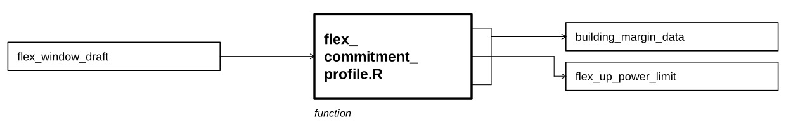

# flex_commitment_profile.R

**Function** &nbsp;·&nbsp; `30_Simulation/05_Models/01_Building/03_Functions/flex_commitment_profile.R`

## Function

Draws the heating and cooling of the Commitment Phase of one flexibility window of a building, for the downward or the upward leg, and the margin data of the building on the rows of the guard zone. This is the part of a window where the two legs differ: the phases are fixed by the system, system_flex_window(), and the simulation and the checks of the building are shared by flex_evaluation().

## Called by

- [flex_window_draft.R](flex_window_draft.md)

## What it calls, in order of appearance

- [building_margin_data.R](building_margin_data.md) &nbsp;(2 call sites)
- [flex_up_power_limit.R](flex_up_power_limit.md)

## Input data

- leg            : Character scalar, "down" or "up".
- period_chunk   : Data frame. Holds the rows of the window. Reads the columns Q_heat_plan, Q_cool_plan and Text_forec.
- flex_rows      : Integer vector. The rows of period_chunk in the Commitment Phase.
- delta_t_h_flex : Numeric vector. The timestep of each of those rows, in hours.
- guard_row      : Logical vector. TRUE for each of those rows that is in the guard zone.
- fraction_row   : Numeric vector. The flexibility fraction of each of those rows, in (0, 1].
- hvac_used      : Character scalar, "heat" or "cool": the system of an upward window, from resolve_flex_up_hvac(). Not read on the downward leg.
- parameters     : Named list. Reads what flex_up_power_limit() reads.
- asset          : Named list. The parameters of the building, its entry of parameters$assets. Read by flex_up_power_limit() and building_margin_data().

## Output data

- Named list with: Q_heat : numeric vector, one entry per row of flex_rows, the heating (kWh) of the itinerary over the Commitment Phase, before the margin Q_cool : the same for cooling margin : the margin data of the building on the rows of the guard zone, as building_margin_data() gives it, or NULL when no row is in the guard zone

## Other notes from the file header

### The downward profile

Heating and cooling are both reduced. With Q_r the planned heat of row r and f the flexibility fraction of the row:

Q_flex_down_r = max( 0, Q_r * (1 - f) )

The max() clips at 0 from below.

### The upward profile

The system that provides the window, s, is raised towards its maximum power, and the other system, s', is switched off. With P_max_s the power that bounds the window (flex_up_power_limit()) and dt_r the timestep of the row in hours:

Q_s_flex_up_r  = min( P_max_s * dt_r,

- Q_s_r + f * (P_max_s * dt_r - Q_s_r) )

Q_s'_flex_up_r = 0

It is the mirror of the downward expression: the min() clips at the physical maximum power. With f = 1 it reduces to P_max_s * dt_r unless the plan was already at, or above, the maximum power.

### The commitment margin

The profile above is the physical side of the window, as drawn before the commitment margin. Its commercial shaping is not decided here: the margin is one, of the set of assets that contribute to the window, and the system applies it (system_commitment_margin()) on the rows of the guard zone, where it keeps flexibility_commitment_margin of net electricity unused against the limit of the set, and brings back to the plan the market slots of a new window that would sell less than minimum_flexibility. The profile with the margin is then put together by flex_margined_profile(). The other rows of a restated window are drawn as the plan allows, without the margin. What the building hands the system for it is its margin data (building_margin_data()), with the heat at the limit of the leg:

- upward, the maximum power of the system that provides the window, the ceiling the window is built against, and nothing of the other system;
- downward, no heat at all, with both systems off.

The electricity of the margin data is measured at the outdoor temperature the itinerary is simulated with, the forecast (Text_forec), so that what the band computes is what the simulation gives.

### Code outline

1. Downward profile
2. Upward profile
    - 2.1. Raise the system towards its maximum power
    - 2.2. The margin data of the building

### Usage instructions

```r
profile <- flex_commitment_profile(
  leg            = "down",
  period_chunk   = period_chunk,
  flex_rows      = flex_rows,
  delta_t_h_flex = delta_t_h_flex,
  guard_row      = guard_row,
  fraction_row   = fraction_row,
  hvac_used      = NULL,
  parameters     = parameters,
  asset          = asset
  )
```

## Diagram



Also available as [flex_commitment_profile.svg](flex_commitment_profile.svg).

---

[Back to the code structure index](../Code_Structure.md)
