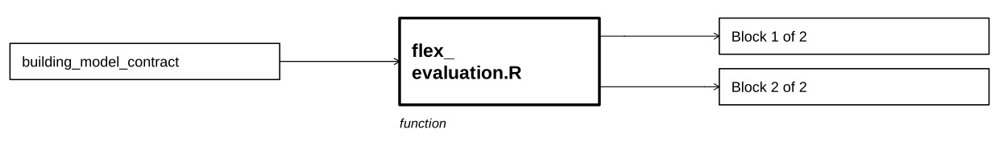

# flex_evaluation.R

**Function** &nbsp;·&nbsp; `30_Simulation/05_Models/01_Building/03_Functions/flex_evaluation.R`

## Function

Draws the contribution of a building to one flexibility window of the system, of one leg, downward or upward. It is the operation window_contribution of the type of model Building (model_type_contract()). The system fixes the window (system_flex_window()): its rows, its three phases, and the time step, guard zone and fraction of flexibility of each row of its Commitment Phase. The building drafts its profile of the Commitment Phase over them (flex_window_draft()), and the system applies to the drafts of all the assets the commitment margin of the set (system_commitment_margin()). With the heat the margin left, this function puts together the heating and cooling of the building during the Commitment Phase (flex_margined_profile()), simulates the Commitment, Neutral and Recovery Phases, writes the itinerary of the leg back into the period chunk, and keeps the contribution only if the building converges back to its plan and the window is a service the building can render. Whether the window is sold is decided by the system, on the net of the contributions of all the assets.

## Called by

- [building_model_contract.R](building_model_contract.md)

## What it calls, in order of appearance

- [flex_margined_profile.R](flex_margined_profile.md)
- [resolve_flex_down_hvac.R](resolve_flex_down_hvac.md)
- [build_hvac_lock_caps.R](build_hvac_lock_caps.md)
- [period_calculation.R](period_calculation.md)
- [flex_refused.R](flex_refused.md) &nbsp;(3 call sites)
- [check_recovery_convergence.R](check_recovery_convergence.md)
- [flex_window_is_feasible.R](flex_window_is_feasible.md)

## Blocks

The piece calls 7 items, so it is documented in blocks:

- [Called items, block 1 of 2](flex_evaluation__1.md)
- [Called items, block 2 of 2](flex_evaluation__2.md)

## Input data

- leg          : Character scalar, "down" or "up". The leg the window belongs to.
- period_chunk : Data frame. Planning-period data, with the phases of the window already written by the system. Must contain the *_plan columns produced by period_calculation() with calculation_context = "plan", and the *_plan_flex_<leg> baseline columns, initialized by derive_flex_itineraries().
- window       : Named list. The window the system fixed, as system_flex_window() builds it:
    - i_flex: the first row of the Commitment Phase
    - rows: the rows of period_chunk the window spans, its initial condition first
    - phase: the phase code of each of those rows (0 for the initial condition, 1 Commitment, 2 Neutral, 3 Recovery)
    - commitment: the positions, within rows, of the rows of the Commitment Phase
    - delta_t_h: the time step of each of those rows, in hours
    - guard_row: TRUE for each of those rows in the guard zone
    - fraction_row: the fraction of flexibility of each of those rows, in (0, 1]
    - restating: TRUE when the window restates a commitment already sold
    - hvac_up: NULL, or a list named by asset_id with "heat" or "cool", the system of each building for a restated upward window, chosen by the caller
    - i_end_control: the last row of the control horizon in period_chunk
- draft        : Named list. The draft of the building for this window, as flex_window_draft() gives it. Reads hvac_used, the system of an upward window, and profile, the profile of the Commitment Phase before the margin.
- margined     : Named list or NULL. The heat of the rows of the guard zone after the commitment margin of the set, list(Q_heat, Q_cool), as system_commitment_margin() gives it for the building. NULL when no row is in the guard zone.
- parameters   : Named list. Model and control parameters. Reads what check_recovery_convergence() and flex_window_is_feasible() read.
- asset        : Named list. The parameters of the building, its entry of parameters$assets. Read by period_calculation(), and handed to flex_window_is_feasible().

## Output data

- A named list with:
- chunk   : Data frame. The input data frame with the *_plan_flex_<leg> columns updated over the rows of the window after its initial condition. A contribution that is not drawn is returned as it came in.
- refusal : Character scalar or NULL. The reason the building refuses the window, one of those of flex_refused(), when its contribution breaks a rule of the building. NULL otherwise.
- drawn   : Logical scalar. TRUE when the building contributes to the window. FALSE when it has nothing to offer on it (a new upward window that raises nothing) or refuses it.

## Other notes from the file header

### The two legs

Both legs are drawn over the same window, with the same simulation and the same checks, so that their results are comparable. Two things differ, and each lives in its own function:

- The profile of the Commitment Phase, flex_commitment_profile() and flex_margined_profile(). The downward leg reduces heating and cooling towards zero; the upward leg raises one system towards its maximum power and switches the other one off.
- The system that provides the contribution. The upward leg needs it before it can draw anything, and the draft of the building already holds it (flex_window_draft()). The downward leg switches off whatever runs, so it only needs the system for the lock of the Recovery Phase, and resolve_flex_down_hvac() reads it from the Commitment Phase once it is drawn.

### The technical rules of the building

The building keeps its contribution only if it keeps the rules of its type, checked within the building:

- its itinerary converges back to its plan by the close of the control horizon (check_recovery_convergence()), for a new window ("no_convergence");
- the windows of the leg do not raise the electricity of both its thermal systems over the plan (flex_window_is_feasible()) ("opposed_hvac");
- during the Recovery Phase, the system that did not provide the service may only hold or reduce its power (build_hvac_lock_caps()).

### Code outline

1. Read the window
2. The system of an upward window
3. Take the rows of the window
4. Draw the Commitment Phase
5. Write the phases fixed by the system
6. Select the system of a downward window
7. Simulate the window
8. Write the contribution back into period_chunk
9. Keep or refuse the contribution

### Usage instructions

Called by system_flex_window(), through the operation window_contribution of the model of the building:

```r
contribution <- flex_evaluation(leg          = "down",
  period_chunk = view,
  window       = window,
  draft        = draft,
  margined     = margined,
  parameters   = parameters,
  asset        = asset)
```

contribution$chunk contribution$refusal contribution$drawn

### Exceptions and special cases

- A restated upward window is drawn with the system the caller hands in, when it hands one in (see flex_window_draft()). The prudence rule of resolve_flex_up_hvac() decides whether a NEW upward window is sold; a window already sold is not dropped because that rule is undecided.
- A restated window is not checked for convergence at the close of the control horizon: its tail may run past it, and the next market rebuilds it.
- During the Recovery Phase the system that did not provide the flexibility service may only hold or reduce its power, never increase it. The restriction is imposed step by step, through calculation_mode 3, so that the bound of every step propagates to the state the next step decides on. It corresponds to an interpretation of the legal regulation of HVAC systems, which does not allow energy management through the alternating use of heating and cooling. See build_hvac_lock_caps().

## Diagram



Also available as [flex_evaluation.svg](flex_evaluation.svg).

---

[Back to the code structure index](../Code_Structure.md)
