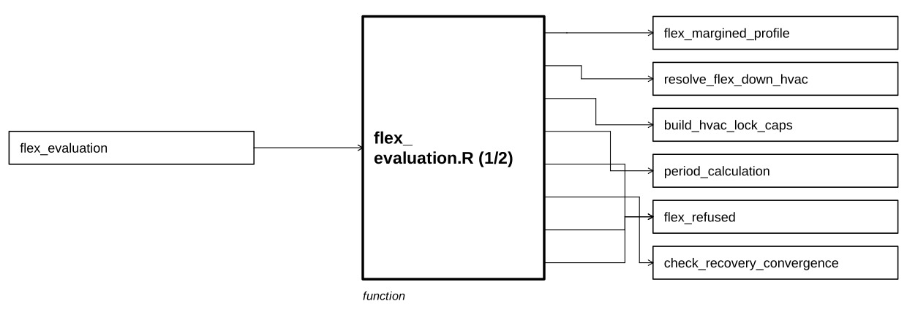

# flex_evaluation.R &mdash; Called items, block 1 of 2

Block 1 of 2 of [flex_evaluation.R](flex_evaluation.md).

## What it calls, in this block

- [flex_margined_profile.R](flex_margined_profile.md)
- [resolve_flex_down_hvac.R](resolve_flex_down_hvac.md)
- [build_hvac_lock_caps.R](build_hvac_lock_caps.md)
- [period_calculation.R](period_calculation.md)
- [flex_refused.R](flex_refused.md)
- [check_recovery_convergence.R](check_recovery_convergence.md)

## Diagram

Also available as [flex_evaluation__1.svg](flex_evaluation__1.svg).

---

[Back to flex_evaluation.R](flex_evaluation.md) &nbsp;·&nbsp; [Back to the code structure index](../Code_Structure.md)
