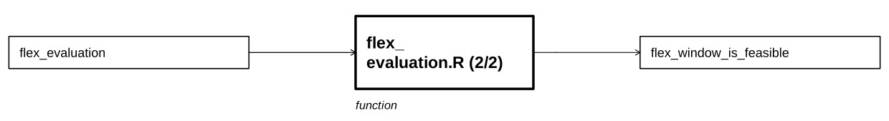

# flex_evaluation.R &mdash; Called items, block 2 of 2

Block 2 of 2 of [flex_evaluation.R](flex_evaluation.md).

## What it calls, in this block

- [flex_window_is_feasible.R](flex_window_is_feasible.md)

## Diagram

Also available as [flex_evaluation__2.svg](flex_evaluation__2.svg).

---

[Back to flex_evaluation.R](flex_evaluation.md) &nbsp;·&nbsp; [Back to the code structure index](../Code_Structure.md)
