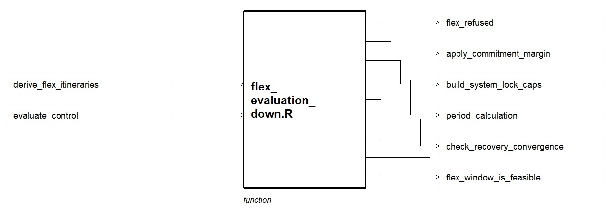

# flex_evaluation_down.R

**Function** &nbsp;·&nbsp; `30_Simulation/03_Functions/flex_evaluation_down.R`

## Function

This function evaluates the impact of a flexibility event on a planning period. It reduces heating and cooling by a given flexibility fraction during the flexibility event, runs a simulation for the Neutral and Recovery Phases, and reconciles the results back into the full period chunk.

## Called by

- [derive_flex_itineraries.R](derive_flex_itineraries.md)
- [evaluate_control.R](evaluate_control.md)

## What it calls, in order of appearance

- [flex_refused.R](flex_refused.md) &nbsp;(4 call sites)
- [apply_commitment_margin.R](apply_commitment_margin.md)
- [build_system_lock_caps.R](build_system_lock_caps.md)
- [period_calculation.R](period_calculation.md)
- [check_recovery_convergence.R](check_recovery_convergence.md)
- [flex_window_is_feasible.R](flex_window_is_feasible.md)

## Input data

- period_chunk             : Data frame. Planning-period data (corresponds to period_chunk_plan in the caller).  Must contain *_plan columns produced by period_calculation with calculation_context = "plan", and matching *_plan_flex_down baseline columns already initialized.
- parameters               : Named list. Model and control parameters.  Must include parameters$control$commitment_phase_length_max, neutral_phase_timespan, recovery_phase_timespan (all in hours), and minimum_flexibility (kW).
- simulation_control       : Named list. Simulation control object. Must contain: simulation_control$indexes_local$i_flex (Integer scalar. Row number in period_chunk at which the flexibility event starts). simulation_control$flexibility$commitment_phase_length (Numeric scalar. Duration of the Commitment Phase (h). Must be <= commitment_phase_length_max.) simulation_control$flexibility$flexibility (Numeric scalar in (0, 1]. Fraction of flexibility to apply (1 = full flexibility, i.e. maximum reduction).)

## Output data

- period_chunk : Data frame. The input data frame with *_plan_flex_down columns updated, plus Flex_phase_down_plan set to the phase code of every row of the window (1 event, 2 Neutral, 3 Recovery; 0 elsewhere, as left by initialize_plan_flex_columns()). Corresponds to period_chunk in the caller. A new window that does not fit before i_end_control is refused (see EXCEPTIONS).

## Other notes from the file header

### Code outline

1. Extract flexibility parameters from simulation_control
2. Modify Q_heat/Q_cool in *_plan_flex_down during flexibility window
3. Mark the event/recovery/Recovery Phases in Flex_phase_down_plan
4. Identify the system used and build the Recovery Phase power caps
5. Run period_calculation for plan_flex_down context
6. Reconcile subset simulation into full period_chunk

### Usage instructions

```r
result_df <- flex_evaluation_down(period_chunk, parameters, simulation_control)
```

### Exceptions and special cases

- simulation_control$indexes_local$i_flex must be a single integer row index within period_chunk.
- simulation_control$flexibility$commitment_phase_length must be <= commitment_phase_length_max.
- simulation_control$flexibility$flexibility must be in (0, 1].
- A new window (not restated) whose Commitment, Neutral and Recovery Phases do not fit before i_end_control is refused ("no_room").
- A restated window (simulation_control$flexibility$restating) is drawn wherever it falls. Only the rows of its Commitment Phase in the guard zone take simulation_control$flexibility$flexibility and the commitment margin; the other rows take simulation_control$flexibility$flexibility_projected and no margin (see derive_flex_itineraries()). It is not checked for convergence at the close of the control horizon.
- This function assumes *_plan_flex_down baseline columns already exist (initialized by evaluate_control() through initialize_plan_flex_columns()).
- During the Recovery Phase the system that did not provide the flexibility service may only hold or reduce its power, never increase it. The restriction is imposed step by step, through calculation_mode 3, so that the bound of every step propagates to the state the next step decides on. It corresponds to an interpretation of the legal regulation of HVAC systems, which does not allow energy management through the alternating use of heating and cooling. See build_system_lock_caps().
- The Q_heat_plan_flex_down and Q_cool_plan_flex_down values during the flex event are set to Q_*_plan * (1 - flexibility), corrected so that they are at least minimum_flexibility * delta_t smaller than the corresponding Q_*_plan values (clamped to 0 from below).
- delta_t is computed in hours, consistent with period_calculation() and period_simulation_cpp.cpp. The project uses kW for power and kWh for energy throughout, so minimum_flexibility (kW) only yields an energy comparable with the Q_* columns (kWh) when multiplied by a timestep in hours.
- COMPUTATIONAL COST: each call here runs period_calculation() once over a bounded window (commitment_phase_length + neutral_phase_timespan + recovery_phase_timespan), so this function's own cost does not grow with the optimization horizon. However, evaluate_control()'s nested market-slot loop can call this function O(L^2) times per evaluation (L = number of market slots in the horizon) - see the COMPUTATIONAL COST note in evaluate_control.R's header for the aggregate cost.

## Diagram



Also available as [flex_evaluation_down.svg](flex_evaluation_down.svg).

---

[Back to the code structure index](../Code_Structure.md)
