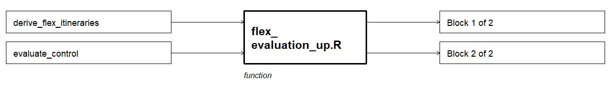

# flex_evaluation_up.R

**Function** &nbsp;·&nbsp; `30_Simulation/03_Functions/flex_evaluation_up.R`

## Function

This function evaluates the impact of an UPWARD flexibility event on a planning period. It raises the selected HVAC system to its maximum power during the Commitment Phase, runs a simulation for the Neutral and Recovery Phases, and reconciles the results back into the full period chunk.

## Called by

- [derive_flex_itineraries.R](derive_flex_itineraries.md)
- [evaluate_control.R](evaluate_control.md)

## What it calls, in order of appearance

- [resolve_flex_up_system.R](resolve_flex_up_system.md)
- [flex_refused.R](flex_refused.md) &nbsp;(4 call sites)
- [apply_commitment_margin.R](apply_commitment_margin.md)
- [build_system_lock_caps.R](build_system_lock_caps.md)
- [period_calculation.R](period_calculation.md)
- [check_recovery_convergence.R](check_recovery_convergence.md)
- [flex_window_is_feasible.R](flex_window_is_feasible.md)

## Blocks

The piece calls 7 items, so it is documented in blocks:

- [Called items, block 1 of 2](flex_evaluation_up__1.md)
- [Called items, block 2 of 2](flex_evaluation_up__2.md)

## Input data

- period_chunk             : Data frame. Planning-period data (corresponds to period_chunk_plan in the caller).  Must contain *_plan columns produced by period_calculation with calculation_context = "plan", and matching *_plan_flex_up baseline columns already initialized.
- parameters               : Named list. Model and control parameters.  Must include parameters$control$commitment_phase_length_max, neutral_phase_timespan, recovery_phase_timespan (all in hours), minimum_flexibility (kW), flex_up_max_power_heating (either "Q_hp_heat_1" or "Q_hp_heat_2", naming which of the two rated heating capacities bounds the event), and the horizons and threshold of resolve_flex_up_system(). parameters$model must include Q_hp_heat_1, Q_hp_heat_2 and Q_hp_cool (all kW).
- simulation_control       : Named list. Simulation control object. Must contain: simulation_control$indexes_local$i_flex (Integer scalar. Row number in period_chunk at which the flexibility event starts). simulation_control$flexibility$commitment_phase_length (Numeric scalar. Duration of the Commitment Phase (h). Must be <= commitment_phase_length_max.) simulation_control$flexibility$flexibility (Numeric scalar in (0, 1]. Fraction of flexibility to apply (1 = full flexibility, i.e. maximum increase).)

## Output data

- period_chunk : Data frame. The input data frame with *_plan_flex_up columns updated, plus Flex_phase_up_plan set to the phase code of every row of the window (1 event, 2 Neutral, 3 Recovery; 0 elsewhere, as left by initialize_plan_flex_columns()). Corresponds to period_chunk in the caller. Returned unchanged if no system can be selected, if there is not enough time remaining from i_flex to accommodate the full flexibility window, or if the window does not increase the energy of the event.

## Other notes from the file header

### How it differs from flex_evaluation_down()

The structure is the same, and deliberately so: the two legs of the service have to be evaluated with the same window, the same phases and the same reconciliation, or their results are not comparable. What changes is what happens during the event.

1. A system has to be selected first. Downward flexibility is symmetric between the two systems - whatever is running gets switched off - but running the wrong system harder would heat a building that needs cooling, so resolve_flex_up_system() decides, and returns "none" when the situation is not clear enough to commit. Then no upward flexibility is offered.
2. During the event the selected system is raised towards its maximum power instead of being reduced towards zero, and the other system is switched off.
3. A window only constitutes a real offer if it actually increases the energy of the event; a plan that was already at maximum power throughout the event has nothing to offer.

The phases, the system lock of the Recovery Phase and the reconciliation are identical to the downward leg.

### The power of the event

With dt_r the timestep of row r in hours, P_max_s the rated power of the selected system s in kW, f the flexibility fraction and q_min the minimum_flexibility in kW:

Q_s_plan_flex_up_r = min( P_max_s * dt_r,

```r
max( Q_s_plan_r + f * (P_max_s * dt_r - Q_s_plan_r),
  Q_s_plan_r + q_min * dt_r ) )
```

Q_s'_plan_flex_up_r = 0

It is the exact mirror of the downward expression. The max() term guarantees an increase of at least q_min * dt_r, as the downward leg guarantees a reduction of at least q_min * dt_r; the outer min() clips at the physical maximum power, as the downward leg clips at 0 from below. With f = 1 it reduces to P_max_s * dt_r unless the plan was already at, or above, the maximum power.

### Code outline

1. Extract flexibility parameters from simulation_control
2. Select the system that may offer upward flexibility
3. Raise Q_heat/Q_cool in *_plan_flex_up during flexibility window
4. Mark the event/recovery/Recovery Phases in Flex_phase_up_plan
5. Build the Recovery Phase power caps
6. Run period_calculation for plan_flex_up context
7. Check that the event really increases the electricity of the building
8. Reconcile subset simulation into full period_chunk

### Usage instructions

```r
result_df <- flex_evaluation_up(period_chunk, parameters, simulation_control)
```

### Exceptions and special cases

- simulation_control$indexes_local$i_flex must be a single integer row index within period_chunk.
- simulation_control$flexibility$commitment_phase_length must be <= commitment_phase_length_max.
- simulation_control$flexibility$flexibility must be in (0, 1].
- If resolve_flex_up_system() returns "none", period_chunk is returned without any changes: there is no system the building can commit to, so there is no upward flexibility to offer.
- A new window (not restated) whose Commitment, Neutral and Recovery Phases do not fit before i_end_control is refused ("no_room").
- A restated window (simulation_control$flexibility$restating) is drawn wherever it falls. Only the rows of its Commitment Phase in the guard zone take simulation_control$flexibility$flexibility and the commitment margin; the other rows take simulation_control$flexibility$flexibility_projected and no margin (see derive_flex_itineraries()). It is not checked for convergence at the close of the control horizon.
- If the Commitment Phase of a new window does not increase the energy of the selected system, period_chunk is returned without any changes. That happens when the plan was already running at maximum power throughout the event, and it is not an error: there is simply nothing left to offer from that start row.
- The same happens, after the simulation, when the window does not increase the building's electricity during the event. The check before the simulation looks only at the selected system, and the event also switches the other one off; if the plan was running that other system on the backup resistances, at COP 1, the event can end up consuming less than the plan. Selling that as upward flexibility would be selling a load reduction at upward prices.
- This function assumes *_plan_flex_up baseline columns already exist (initialized by evaluate_control() through initialize_plan_flex_columns()).
- The maximum heating power is either Q_hp_heat_1 or Q_hp_heat_2, selected by parameters$control$flex_up_max_power_heating. The two are the rated capacities of the two operating points of the heat pump, and which of them bounds an upward event is a modelling decision rather than a fact of the equipment, so it is left as a parameter. Raising heating above Q_hp_heat_1 is served by the backup resistances, at COP 1, which the electricity calculation of period_simulation_cpp.cpp already accounts for.
- delta_t is computed in hours, consistent with period_calculation() and period_simulation_cpp.cpp. The project uses kW for power and kWh for energy throughout, so the rated powers (kW) only yield an energy comparable with the Q_* columns (kWh) when multiplied by a timestep in hours.
- During the Recovery Phase the system that did not provide the service may only hold or reduce its power, never increase it. The restriction is imposed step by step, through calculation_mode 3, and corresponds to an interpretation of the legal regulation of HVAC systems, which does not allow energy management through the alternating use of heating and cooling. See build_system_lock_caps().
- COMPUTATIONAL COST: as in flex_evaluation_down(), each call runs period_calculation() once over a bounded window, so this function's own cost does not grow with the optimization horizon.

## Diagram



Also available as [flex_evaluation_up.svg](flex_evaluation_up.svg).

---

[Back to the code structure index](../Code_Structure.md)
