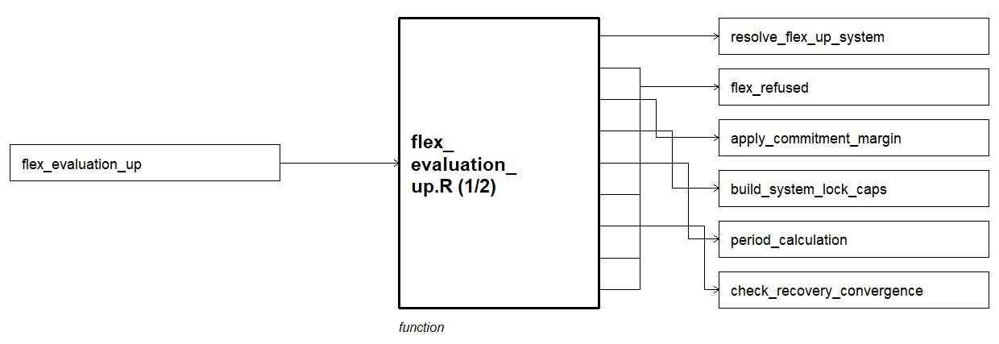

# flex_evaluation_up.R &mdash; Called items, block 1 of 2

Block 1 of 2 of [flex_evaluation_up.R](flex_evaluation_up.md).

## What it calls, in this block

- [resolve_flex_up_system.R](resolve_flex_up_system.md)
- [flex_refused.R](flex_refused.md)
- [apply_commitment_margin.R](apply_commitment_margin.md)
- [build_system_lock_caps.R](build_system_lock_caps.md)
- [period_calculation.R](period_calculation.md)
- [check_recovery_convergence.R](check_recovery_convergence.md)

## Diagram

Also available as [flex_evaluation_up__1.svg](flex_evaluation_up__1.svg).

---

[Back to flex_evaluation_up.R](flex_evaluation_up.md) &nbsp;·&nbsp; [Back to the code structure index](../Code_Structure.md)
