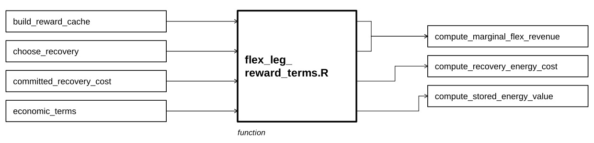

# flex_leg_reward_terms.R

**Function** &nbsp;·&nbsp; `30_Simulation/03_Functions/flex_leg_reward_terms.R`

## Function

Computes, for one flexibility leg ("down" or "up"), the terms that leg adds to the economic part of the reward (economic_terms()):

- its commitment signal: the energy the leg commits during its Commitment Phase, as a non-negative series;
- the commitment revenue: that signal valued at the commitment price alone;
- the execution revenue: the same signal valued at the execution price times the activation probability;
- the Recovery Phase cost: the energy the building would move while returning to its plan if the service were called. economic_terms() values it as the change against the cost of the itineraries already committed (committed_recovery_cost());
- when an asset stores energy, the value of the energy the leg leaves stored against the plan: the difference between the change of the stored energy of the leg and that of the plan, weighted by the activation probability of the leg on each row and valued at the price of the stored energy (compute_stored_energy_value()). If the service were called and the Recovery Phase did not bring the stored energy back, the leg would leave that energy stored or spent. economic_terms() values it as the change against what the committed itineraries leave (committed_recovery_cost()).

It is part of the system side of the reward: it reads only the rows of system_energy_rows(), that is the net electricity of the system in each itinerary, the phases of the legs, the prices and the probabilities, never a temperature, a mode or a setpoint. The two legs are independent: each term reads only the rows of its own leg and the plan, so a caller that keeps one leg fixed can compute its terms once and reuse them.

## Called by

- [build_reward_cache.R](build_reward_cache.md)
- [choose_recovery.R](choose_recovery.md)
- [committed_recovery_cost.R](committed_recovery_cost.md)
- [economic_terms.R](economic_terms.md)

## What it calls, in order of appearance

- [compute_marginal_flex_revenue.R](compute_marginal_flex_revenue.md) &nbsp;(2 call sites)
- [compute_recovery_energy_cost.R](compute_recovery_energy_cost.md)
- [compute_stored_energy_value.R](compute_stored_energy_value.md)

## Input data

- system_rows        : Named list, as returned by system_energy_rows(). Its market interval, its net electricity of the plan and of this leg's itinerary, its phase, its row prices and its activation probability of this leg are used, and, when it holds it, the change of the stored energy of the plan and of this leg.
- leg                : Character. "down" or "up".
- marginal_context   : Named list, as returned by resolve_marginal_context(). Its activation probability of the leg by market interval and its price of the stored energy are used for the value of the stored energy.
- reward_cache       : Named list, as returned by build_reward_cache(). Its revenue discount factors (per target interval and per row) and its target interval of each row are used. When its fixed_leg is this leg, its fixed_terms are returned as they are.

## Output data

- Named list:
    - commitment    : numeric vector, one value per row
    - com_revenue   : numeric scalar (EUR)
    - exec_revenue  : numeric scalar (EUR)
    - recovery_cost : numeric scalar (EUR)
    - stored_value  : numeric scalar (EUR). Only when system_rows holds the change of the stored energy: the value of the energy the leg leaves stored against the plan.

## Other notes from the file header

### Code outline

0. The fixed leg
1. Commitment signal of the leg
2. Commitment and execution revenue
3. Recovery Phase cost
4. Value of the energy the leg leaves stored

### Usage instructions

```r
terms <- flex_leg_reward_terms(system_rows, "down", marginal_context,
  reward_cache)
```

## Diagram



Also available as [flex_leg_reward_terms.svg](flex_leg_reward_terms.svg).

---

[Back to the code structure index](../Code_Structure.md)
