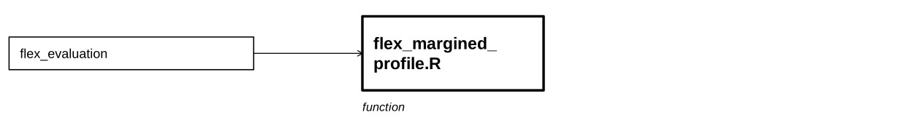

# flex_margined_profile.R

**Function** &nbsp;·&nbsp; `30_Simulation/05_Models/01_Building/03_Functions/flex_margined_profile.R`

## Function

Puts together the heating and cooling of the Commitment Phase of the contribution of a building to a flexibility window, once the system has applied the commitment margin of the set of assets (system_commitment_margin()). The building drew its profile before the margin (flex_commitment_profile()); here the rows of the guard zone take the heat the margin left.

## Called by

- [flex_evaluation.R](flex_evaluation.md)

## What it calls, in order of appearance

- Nothing: this piece calls no other piece of the project.

## Input data

- leg         : Character scalar, "down" or "up".
- profile     : Named list. The profile of the Commitment Phase before the margin, as flex_commitment_profile() gives it. Reads Q_heat and Q_cool (kWh), one entry per row of the Commitment Phase.
- margined    : Named list or NULL. The heat of the rows of the guard zone after the margin, list(Q_heat, Q_cool), as system_commitment_margin() gives it for the building. NULL when no row is in the guard zone.
- guard_row   : Logical vector, one entry per row of the Commitment Phase. TRUE for each row in the guard zone.
- hvac_used   : Character scalar, "heat" or "cool": the system of an upward window. Not read on the downward leg.
- Q_heat_plan : Numeric vector. The heating of the plan on the rows of the Commitment Phase (kWh).
- Q_cool_plan : Numeric vector. The cooling of the plan on those rows (kWh).
- restating   : Logical scalar. TRUE when the window restates a commitment already sold.

## Output data

- Named list with two numeric vectors, one entry per row of the Commitment Phase, in kWh: Q_heat : heating of the itinerary over the Commitment Phase Q_cool : cooling of the itinerary over the Commitment Phase NULL when a new upward window does not increase the energy of its system.

## Other notes from the file header

### The two legs

- Downward: the heating and the cooling of the rows of the guard zone are those the margin left.
- Upward: the system that provides the window takes the heat the margin left, and the other system stays off. The margin scales the departure of the itinerary from the plan on both systems, and would otherwise bring part of the power of the other system back, which the simulation, where heating and cooling exclude each other at every step, has no way to fly. Dropping it only lowers the electricity of the itinerary, so the headroom the margin secured is kept and, where the plan ran the other system, a little more.

A new upward window that does not increase the energy of its system is not an offer: the plan was already at maximum power, or the margin left no room to raise anything. A restated window is still drawn: what it commits is then what the new plan allows, and the caller decides what to do with the shortfall.

### Code outline

1. The rows of the guard zone
2. Check that an upward window raises something

### Usage instructions

```r
final <- flex_margined_profile(
  leg         = "up",
  profile     = profile,
  margined    = margined,
  guard_row   = guard_row,
  hvac_used   = "heat",
  Q_heat_plan = Q_heat_plan,
  Q_cool_plan = Q_cool_plan,
  restating   = FALSE
  )
```

## Diagram



Also available as [flex_margined_profile.svg](flex_margined_profile.svg).

---

[Back to the code structure index](../Code_Structure.md)
