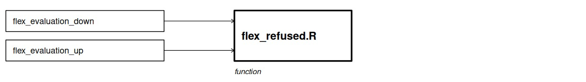

# flex_refused.R

**Function** &nbsp;·&nbsp; `30_Simulation/03_Functions/flex_refused.R`

## Function

Tags a period chunk that flex_evaluation_down() or flex_evaluation_up() is returning unbuilt, with the reason why.

## Called by

- [flex_evaluation_down.R](flex_evaluation_down.md)
- [flex_evaluation_up.R](flex_evaluation_up.md)

## What it calls, in order of appearance

- Nothing: this piece calls no other piece of the project.

## Input data

- period_chunk : Data frame. The chunk the builder is returning.
- reason       : Character scalar. One of "no_room", "row_mismatch", "no_convergence", "opposed_systems".

## Output data

- The same data frame, carrying the reason in the attribute "flex_refusal". A chunk the builder did build carries no such attribute, so attr(x, "flex_refusal") is NULL exactly when the window was accepted.

## Other notes from the file header

### Why a reason is needed

The two builders have four exits that return the chunk untouched: the window does not fit the control horizon, a defensive row check fails, the recovery does not converge, and the two thermal systems would be raised at once. Only the last of those is technical infeasibility in the sense the rule was written for, and only that one should reach the reward as such. Without this tag, the caller would have to guess from the rebuilt phases, for instance by testing whether the phase is all zero. That test only holds for the first window of a leg: from the second on the chunk already carries the phases of the earlier ones, so a refusal would go unnoticed and the standing commitment would be lost in silence.

### Code outline

1. Check the reason is one of the four
2. Tag and return

### Usage instructions

```r
return(flex_refused(period_chunk, "no_room"))
```

and, on the reading side:

```r
reason <- attr(built, "flex_refusal")
```

## Diagram



Also available as [flex_refused.svg](flex_refused.svg).

---

[Back to the code structure index](../Code_Structure.md)
