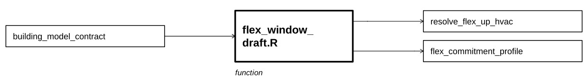

# flex_window_draft.R

**Function** &nbsp;·&nbsp; `30_Simulation/05_Models/01_Building/03_Functions/flex_window_draft.R`

## Function

Drafts the contribution of a building to one flexibility window of the system, of one leg, downward or upward: the heating and cooling of its Commitment Phase as drawn before the commitment margin, and the margin data it hands the system. It is the operation window_draft of the type of model Building (model_type_contract()). The system fixes the window (system_flex_window()). The margin is one, of the set of assets that contribute to it, so the system first asks every asset for its draft, then applies the margin to the set (system_commitment_margin()), and only then lets each asset simulate its contribution with the heat the margin left (flex_evaluation()).

## Called by

- [building_model_contract.R](building_model_contract.md)

## What it calls, in order of appearance

- [resolve_flex_up_hvac.R](resolve_flex_up_hvac.md)
- [flex_commitment_profile.R](flex_commitment_profile.md)

## Input data

- leg          : Character scalar, "down" or "up". The leg the window belongs to.
- period_chunk : Data frame. The view of the asset of the piece (see piece_asset_view()), with the phases of the window already written by the system. Reads what resolve_flex_up_hvac() and flex_commitment_profile() read.
- window       : Named list. The window the system fixed, as system_flex_window() builds it. Reads i_flex, rows, commitment, delta_t_h, guard_row, fraction_row, restating and hvac_up (see flex_evaluation()).
- parameters   : Named list. Model and control parameters. Reads what resolve_flex_up_hvac() and flex_commitment_profile() read.
- asset        : Named list. The parameters of the building, its entry of parameters$assets. Read by flex_commitment_profile().

## Output data

- A named list, the draft of the building:
- drawn     : Logical scalar. FALSE when the building has nothing to offer on the window (an upward window with no dominant system); the other fields are then absent.
- hvac_used : Character scalar, "heat" or "cool", the system of an upward window; NULL on the downward leg.
- profile   : The profile of the Commitment Phase before the margin, as flex_commitment_profile() gives it, or NULL when the window has no row in its Commitment Phase.
- margin    : The margin data of the building on the rows of the guard zone (building_margin_data()), or NULL when no row is in the guard zone.

## Other notes from the file header

### The system of an upward window

The upward leg raises one system, so it has to know which one before anything is drawn, because running the wrong system harder would heat a building that needs cooling. A restated window may come with the system of the building, under its asset_id, chosen by the caller among those that deliver what was sold (see derive_flex_itineraries()). Otherwise the prudence rule of resolve_flex_up_hvac() chooses it from the first row of the Commitment Phase, and without a dominant system the building has nothing to offer. The downward leg switches off whatever runs, so it needs no system to be drafted.

### Code outline

1. Read the leg
2. Select the system of an upward window
3. Draw the Commitment Phase

### Usage instructions

Called by system_flex_window(), through the operation window_draft of the model of the building:

```r
draft <- flex_window_draft(leg          = "down",
  period_chunk = view,
  window       = window,
  parameters   = parameters,
  asset        = asset)
```

## Diagram



Also available as [flex_window_draft.svg](flex_window_draft.svg).

---

[Back to the code structure index](../Code_Structure.md)
