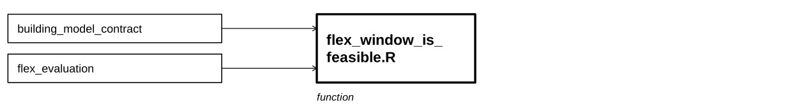

# flex_window_is_feasible.R

**Function** &nbsp;·&nbsp; `30_Simulation/05_Models/01_Building/03_Functions/flex_window_is_feasible.R`

## Function

Says whether a flexibility window is technically feasible: inside it, the itinerary may not raise the electricity of BOTH thermal systems over the _plan itinerary. The system that provides the service may go up; the other one may not. The rule is a rule of one building: it judges the two thermal systems of the building whose itineraries period_chunk holds. It is the operation window_feasible of the type of model of a building (model_type_contract()), so that the reward checks it for each building and each leg, and two buildings may raise one system each.

## Called by

- [building_model_contract.R](building_model_contract.md)
- [flex_evaluation.R](flex_evaluation.md)

## What it calls, in order of appearance

- Nothing: this piece calls no other piece of the project.

## Input data

- period_chunk : Data frame. Must carry, for the leg being judged, the phase column and the four electricity columns named below.
- leg          : Character. "down" or "up".
- parameters   : Named list. parameters$control$flex_feasibility_tolerance (%) and parameters$control$flex_feasibility_floor (kWh).
- asset        : Named list. The parameters of the building, its entry of parameters$assets. Every operation of the type of model receives them; the rule reads none of them, since the tolerance and the floor are of the system.

## Output data

- Logical scalar. TRUE when the window may be committed, FALSE when both systems raise their electricity over the plan beyond the tolerance. A chunk with no window at all is feasible: there is nothing to judge.

## Other notes from the file header

### Why the whole window and not each phase

The case this rule exists to forbid splits the increase between the Commitment Phase and the Recovery Phase - heating up front, cooling on the way back - and raises both systems at no single instant. A rule applied phase by phase, or step by step, would see nothing wrong in either half. Measured over the three phases at once, it is caught.

### Why electricity and not heat

The same thermal increment costs different electricity depending on the COP, and above Q_hp_heat_1 the surplus is served at COP 1. What is sold and what is paid for is electricity, so that is what is measured.

### The tolerance

It is the larger of a share of the dominant increment and an absolute floor, both read from 08_Flexibility_Event_Configuration.csv:

- tol = max(flex_feasibility_tolerance/100 * max(|inc_heat|, |inc_cool|), flex_feasibility_floor)

The dominant system always clears its own share - its increment IS the maximum, and a positive number always exceeds its own five per cent - so the condition reduces to asking whether the secondary system's increment passes that tolerance. The floor is not numerical residue: an increment under a quarter of a kilowatt hour does not count as a decision, whoever made it. The two meet at a dominant increment of 5 kWh with the production values.

### Code outline

1. The rows of the window, and the two increments over the plan
2. The tolerance, and the verdict

### Usage instructions

if (!flex_window_is_feasible(period_chunk, "up", parameters,

- asset)) { ... }

### Exceptions and special cases

- The rule is applied to both legs. Downward, the phenomenon is less likely - cutting consumption does not push the other system - and it is not observed in any available run, but the symmetry costs nothing and leaves that leg covered if a recovery ever pushes it.
- It does not forbid one system rising while the other FALLS. That case exists and is frequent in warm weather, and it is allowed: the service sold is real and the other system switching itself off is a consequence of the control, not an order.
- build_hvac_lock_caps() already forbids the non-providing system from raising its power during the Recovery Phase. That lock shapes the itinerary while it is simulated; this rule judges the finished window. Both are kept.

## Diagram

Also available as [flex_window_is_feasible.svg](flex_window_is_feasible.svg).

---

[Back to the code structure index](../Code_Structure.md)
