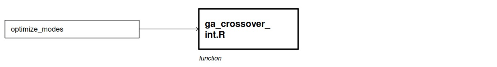

# ga_crossover_int.R

**Function** &nbsp;·&nbsp; `30_Simulation/03_Functions/ga_crossover_int.R`

## Function

Custom crossover operator for integer mode variables. Performs uniform crossover using the actual parent chromosomes selected by GA from object@population. All output values remain integers within the same discrete domain already present in the parent chromosomes. It is one of the three integer operators that optimize_modes() hands to ga(): the modes are whole numbers, and these operators keep every gene a whole mode number inside its bounds.

## Called by

- [optimize_modes.R](optimize_modes.md)

## What it calls, in order of appearance

- Nothing: this piece calls no other piece of the project.

## Input data

- object   : GA object (from ga package)
- parents  : Integer vector with the row indexes of the selected parents in object@population.

## Output data

- list with two elements: children : Matrix with 2 rows (offspring chromosomes) and n_genes columns, containing integer mode indices. fitness  : Numeric vector of length 2 with NA values (fitness will be evaluated separately by GA).

## Other notes from the file header

### Usage instructions

```r
offspring <- ga_crossover_int(object, parents)
```

### Code outline

1. Take the two parents out of the population.
2. Uniform crossover: for each gene, one child takes it from one parent and the other child from the other, with equal probability, so every gene stays a whole mode number.

## Diagram



Also available as [ga_crossover_int.svg](ga_crossover_int.svg).

---

[Back to the code structure index](../Code_Structure.md)
