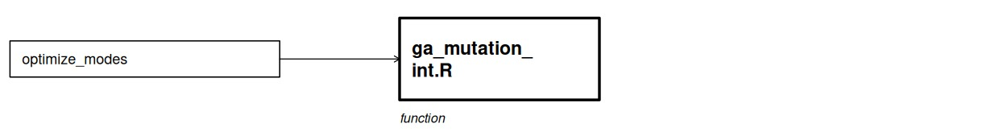

# ga_mutation_int.R

**Function** &nbsp;·&nbsp; `30_Simulation/03_Functions/ga_mutation_int.R`

## Function

Custom mutation operator for integer mode variables. Receives the selected parent chromosome from object@population and, for each gene, with probability pmutation, replaces the current mode index with a randomly selected valid mode index. All output values remain integers within the declared bounds. It is one of the three integer operators that optimize_modes() hands to ga(): the modes are whole numbers, and these operators keep every gene a whole mode number inside its bounds.

## Called by

- [optimize_modes.R](optimize_modes.md)

## What it calls, in order of appearance

- Nothing: this piece calls no other piece of the project.

## Input data

- object   : GA object (from ga package) containing lower and upper bounds
- parent   : Integer scalar with the row index of the selected parent in object@population.

## Output data

- Numeric vector representing the mutated chromosome (integer mode indices)

## Other notes from the file header

### Usage instructions

```r
mutated <- ga_mutation_int(object, parent)
```

### Code outline

1. Read the bounds and the mutation probability.
2. Redraw each gene that the probability selects, uniformly between its bounds.

## Diagram



Also available as [ga_mutation_int.svg](ga_mutation_int.svg).

---

[Back to the code structure index](../Code_Structure.md)
