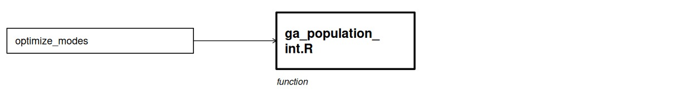

# ga_population_int.R

**Function** &nbsp;·&nbsp; `30_Simulation/03_Functions/ga_population_int.R`

## Function

Custom population generator for the genetic algorithm that creates initial population with integer values representing mode indices. Each gene is a valid mode index in the range [1, n_modes]. It is one of the three integer operators that optimize_modes() hands to ga(): the modes are whole numbers, and these operators keep every gene a whole mode number inside its bounds.

## Called by

- [optimize_modes.R](optimize_modes.md)

## What it calls, in order of appearance

- Nothing: this piece calls no other piece of the project.

## Input data

- object : GA object (from ga package) containing lower and upper bounds

## Output data

- matrix : Population matrix where each row is an individual (chromosome) and each column is a gene (mode index for one market period). All values are integers in the range defined by lower/upper bounds.

## Other notes from the file header

### Usage instructions

```r
population <- ga_population_int(object)
```

### Code outline

1. Read the integer bounds and the population size from the GA object.
2. Draw one whole mode number per gene and per individual, uniformly between those bounds.

## Diagram



Also available as [ga_population_int.svg](ga_population_int.svg).

---

[Back to the code structure index](../Code_Structure.md)
